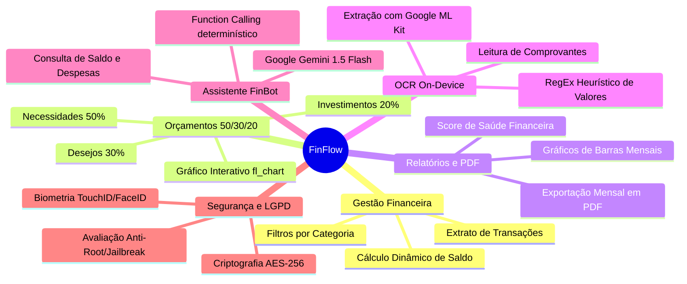

# 💸 FinFlow — Gestão Financeira Inteligente & Offline-First

> Aplicativo móvel enterprise de finanças pessoais desenvolvido em **Flutter** com **Clean Architecture (Feature-First)**, persistência criptografada **Offline-First (AES-256 / SQLCipher)**, inteligência artificial generativa com **Function Calling (Google Gemini SDK)**, reconhecimento de recibos via **OCR On-Device (Google ML Kit)** e conformidade rigorosa com a **LGPD** e padrões de segurança do setor público.

---

## 🏛️ Propósito e Contexto de Engenharia

O **FinFlow** foi concebido não apenas como uma solução de controle financeiro pessoal, mas como uma **prova de conceito (PoC) de alta maturidade técnica** para defender e demonstrar o poder do ecossistema Flutter em aplicações críticas de governo e setor público (com foco na administração pública e secretarias de estado).

O projeto adota os mais rigorosos padrões da indústria de desenvolvimento de software:
* **Clean Architecture** orientada a Features (*Feature-First*).
* **Gerenciamento de Estado Reativo e Previsível** com **BLoC (Business Logic Component)**.
* **Segurança e Privacidade por Design (Privacy by Design)**: dados 100% locais, protegidos com criptografia em repouso e autenticação biométrica.
* **Inteligência Artificial Integrada**: assistente virtual capaz de executar ações no aplicativo através de chamadas de funções determinísticas (*Function Calling*).

---

## ✨ Principais Funcionalidades



### 1. 📊 Extrato & Fluxo de Caixa (Offline-First)
* Registro rápido de receitas e despesas com categorização visual.
* Cards com métricas consolidadas (Saldo Total, Entradas, Saídas).
* Filtros rápidos por tipo e ordenação temporal.

### 2. 🎯 Orçamentos e Regra 50/30/20
* Implementação visual da clássica regra orçamentária:
  * **50% — Necessidades Básicas** (Moradia, Alimentação, Saúde).
  * **30% — Desejos Pessoais** (Lazer, Restaurantes, Assinaturas).
  * **20% — Futuro & Investimentos** (Reserva de Emergência, Aposentadoria).
* Gráfico de rosca dinâmico com **`fl_chart`** exibindo porcentagens em tempo real e alertas de teto de gastos.

### 3. 📄 Relatórios & Exportação em PDF
* Score de saúde financeira calculado dinamicamente de 0 a 100 com base na poupança e cumprimento dos orçamentos.
* Exportação e compartilhamento de relatórios em **PDF profissional formatado** usando os pacotes `pdf` e `printing`.

### 4. 📸 Digitalização de Comprovantes On-Device (OCR)
* Reconhecimento óptico de caracteres direto no smartphone através do **Google ML Kit Text Recognition**.
* Extração automática de valores monetários, datas e nomes de estabelecimentos utilizando heurísticas regex, sem enviar fotos dos comprovantes para servidores externos (máxima privacidade).

### 5. 🤖 FinBot: Assistente Virtual com IA & Function Calling
* Integração direta com a API oficial do **Google Gemini** (`google_generative_ai`).
* **Function Calling nativo**: A IA não apenas responde dúvidas, mas é capaz de executar ações reais no app, como:
  * `addTransaction(amount, description, category, type)`: Registra despesas diretamente da conversa ("*FinBot, gastei 45 reais na padaria hoje*").
  * `getBalance()`: Consulta o saldo consolidado atual do usuário para responder com precisão matemática.

### 6. 🛡️ Segurança, Biometria & LGPD
* **Security Gate**: Tela inicial que avalia a integridade do dispositivo contra Root/Jailbreak antes de liberar a chave de decodificação.
* **Autenticação Biométrica**: Integração com TouchID, FaceID e leitores de digital nativos via `local_auth`.
* **Degradação Graciosa (Graceful Degradation)**: Detecção automática de ambiente (`kIsWeb`) e modo de contingência por PIN numérico para testes em navegador e emuladores.

---

## 🏗️ Arquitetura de Software

O FinFlow segue o padrão **Clean Architecture** organizado por funcionalidades (**Feature-First**), desacoplando a interface com o usuário das regras de negócio e da camada de persistência:

```
lib/
├── core/                       # Serviços compartilhados, segurança e temas
│   ├── database/               # Persistência Drift (SQLite Criptografado)
│   ├── di/                     # Injeção de dependências (GetIt)
│   ├── error/                  # Mapeamento funcional de falhas (Failures)
│   ├── security/               # Biometria, Keystore/Keychain e Device Security
│   ├── services/               # Geração de PDF e utilitários
│   ├── theme/                  # Paleta Dark Theme e tipografia Material 3
│   └── usecase/                # Contrato base de Casos de Uso (Either<Failure, T>)
│
└── features/                   # Módulos verticais independentes
    ├── auth/                   # Security Gate e desbloqueio biométrico
    ├── transactions/           # Transações, extrato e métricas de saldo
    ├── budgets/                # Orçamentos da regra 50/30/20
    ├── insights/               # Gráficos de barra, score e exportação em PDF
    ├── receipts/               # Scanner de comprovantes com OCR On-Device
    └── ai_assistant/           # Chatbot FinBot com Gemini e Function Calling
```

Cada funcionalidade interna é subdividida nas três camadas da Clean Architecture:
* **`domain/`**: Entidades puras do negócio, interfaces de repositórios e Casos de Uso (`UseCases`). Sem dependência de bibliotecas de terceiros ou de UI.
* **`data/`**: Modelos de transferência (`DTOs`), DataSources locais/remotos e implementações concretas dos repositórios.
* **`presentation/`**: Gerência de estado com `flutter_bloc` (`Events`, `States`, `Blocs`) e interfaces visuais (`Pages`, `Widgets`).

---

## 🤖 Engenharia Orientada a Agentes de IA

Este projeto foi desenhado e estruturado utilizando o paradigma de **Engenharia de Software com Multi-Agentes de IA** no Google Antigravity:

| Agente | Papel | Responsabilidade Principal |
| :--- | :--- | :--- |
| **`tech-lead-architect`** | Tech Lead & Arquiteto | Desenho da Clean Architecture, injeção de dependências e contratos |
| **`flutter-mobile-engineer`** | Engenheiro Flutter Sênior | Implementação das telas, BLoCs, persistência Drift e gráficos `fl_chart` |
| **`security-lgpd-officer`** | Especialista em Segurança & LGPD | Modelagem de ameaças OWASP Mobile Top 10 e auditoria de dados |
| **`scrum-po-lead`** | Product Owner & Scrum Master | Especificação das sprints, histórias de usuário em formato BDD/Gherkin |

---

## 🚀 Como Executar o Projeto

### Pré-requisitos
* **Flutter SDK**: versão `3.24.0` ou superior (recomendado `3.47+`)
* **Dart SDK**: `3.5+`
* **Google Chrome** (para execução Web rápida) ou **Android Studio** com Emulador Android configurado.

### 1. Clonar o Repositório
```bash
git clone https://github.com/CaioMMelo/FinFlow.git
cd FinFlow
```

### 2. Instalar Dependências
```bash
flutter pub get
```

### 3. Executar os Testes Unitários
```bash
flutter test
```

### 4. Executar no Navegador (Google Chrome)
```bash
flutter run -d chrome
```

### 5. Executar no Emulador Android
Com o emulador ligado no Android Studio:
```bash
flutter run
```

---

## 📚 Documentação Técnica Complementar

O diretório [`docs/`](docs/) contém estudos aprofundados produzidos durante a concepção do projeto:
* 📘 [Dossiê Técnico de Flutter para o Setor Público](docs/dossie_tecnico_estudo_flutter_gov.md)
* 🔐 [Auditoria de Segurança, OWASP Mobile e LGPD](docs/seguranca_lgpd_setor_publico.md)
* 🤖 [Guia de Estudo: Google Gemini & Function Calling em Flutter](docs/guia_estudo_gemini_function_calling_flutter.md)
* 📐 [Master Blueprint de Arquitetura Multi-Agentes](docs/master_blueprint_financas_flutter_agentes.md)
* 🏃 [Especificação Ágil: Sprint 2 (Orçamentos 50/30/20)](docs/sprint2_orcamentos_metas.md)
* 📱 [Protótipo Visual Interativo (HTML/CSS)](docs/finflow_visual_prototype.html)

---

## 👤 Autor

Desenvolvido por **Caio Melo**  
* GitHub: [@CaioMMelo](https://github.com/CaioMMelo)  
* Email: [caio.v.mangueira@gmail.com](mailto:caio.v.mangueira@gmail.com)

---

## 🏛️ Propósito e Contexto de Engenharia

O **FinFlow** foi concebido não apenas como uma solução de controle financeiro pessoal, mas como uma **prova de conceito (PoC) de alta maturidade técnica** para defender e demonstrar o poder do ecossistema Flutter em aplicações críticas de governo e setor público (com foco na administração pública e secretarias de estado).

O projeto adota os mais rigorosos padrões da indústria de desenvolvimento de software:
* **Clean Architecture** orientada a Features (*Feature-First*).
* **Gerenciamento de Estado Reativo e Previsível** com **BLoC (Business Logic Component)**.
* **Segurança e Privacidade por Design (Privacy by Design)**: dados 100% locais, protegidos com criptografia em repouso e autenticação biométrica.
* **Inteligência Artificial Integrada**: assistente virtual capaz de executar ações no aplicativo através de chamadas de funções determinísticas (*Function Calling*).

---

## ✨ Principais Funcionalidades


### 1. 📊 Extrato & Fluxo de Caixa (Offline-First)
* Registro rápido de receitas e despesas com categorização visual.
* Cards com métricas consolidadas (Saldo Total, Entradas, Saídas).
* Filtros rápidos por tipo e ordenação temporal.

### 2. 🎯 Orçamentos e Regra 50/30/20
* Implementação visual da clássica regra orçamentária:
  * **50% — Necessidades Básicas** (Moradia, Alimentação, Saúde).
  * **30% — Desejos Pessoais** (Lazer, Restaurantes, Assinaturas).
  * **20% — Futuro & Investimentos** (Reserva de Emergência, Aposentadoria).
* Gráfico de rosca dinâmico com **`fl_chart`** exibindo porcentagens em tempo real e alertas de teto de gastos.

### 3. 📄 Relatórios & Exportação em PDF
* Score de saúde financeira calculado dinamicamente de 0 a 100 com base na poupança e cumprimento dos orçamentos.
* Exportação e compartilhamento de relatórios em **PDF profissional formatado** usando os pacotes `pdf` e `printing`.

### 4. 📸 Digitalização de Comprovantes On-Device (OCR)
* Reconhecimento óptico de caracteres direto no smartphone através do **Google ML Kit Text Recognition**.
* Extração automática de valores monetários, datas e nomes de estabelecimentos utilizando heurísticas regex, sem enviar fotos dos comprovantes para servidores externos (máxima privacidade).

### 5. 🤖 FinBot: Assistente Virtual com IA & Function Calling
* Integração direta com a API oficial do **Google Gemini** (`google_generative_ai`).
* **Function Calling nativo**: A IA não apenas responde dúvidas, mas é capaz de executar ações reais no app, como:
  * `addTransaction(amount, description, category, type)`: Registra despesas diretamente da conversa ("*FinBot, gastei 45 reais na padaria hoje*").
  * `getBalance()`: Consulta o saldo consolidado atual do usuário para responder com precisão matemática.

### 6. 🛡️ Segurança, Biometria & LGPD
* **Security Gate**: Tela inicial que avalia a integridade do dispositivo contra Root/Jailbreak antes de liberar a chave de decodificação.
* **Autenticação Biométrica**: Integração com TouchID, FaceID e leitores de digital nativos via `local_auth`.
* **Degradação Graciosa (Graceful Degradation)**: Detecção automática de ambiente (`kIsWeb`) e modo de contingência por PIN numérico para testes em navegador e emuladores.

---

## 🏗️ Arquitetura de Software

O FinFlow segue o padrão **Clean Architecture** organizado por funcionalidades (**Feature-First**), desacoplando a interface com o usuário das regras de negócio e da camada de persistência:

```
lib/
├── core/                       # Serviços compartilhados, segurança e temas
│   ├── database/               # Persistência Drift (SQLite Criptografado)
│   ├── di/                     # Injeção de dependências (GetIt)
│   ├── error/                  # Mapeamento funcional de falhas (Failures)
│   ├── security/               # Biometria, Keystore/Keychain e Device Security
│   ├── services/               # Geração de PDF e utilitários
│   ├── theme/                  # Paleta Dark Theme e tipografia Material 3
│   └── usecase/                # Contrato base de Casos de Uso (Either<Failure, T>)
│
└── features/                   # Módulos verticais independentes
    ├── auth/                   # Security Gate e desbloqueio biométrico
    ├── transactions/           # Transações, extrato e métricas de saldo
    ├── budgets/                # Orçamentos da regra 50/30/20
    ├── insights/               # Gráficos de barra, score e exportação em PDF
    ├── receipts/               # Scanner de comprovantes com OCR On-Device
    └── ai_assistant/           # Chatbot FinBot com Gemini e Function Calling
```

Cada funcionalidade interna é subdividida nas três camadas da Clean Architecture:
* **`domain/`**: Entidades puras do negócio, interfaces de repositórios e Casos de Uso (`UseCases`). Sem dependência de bibliotecas de terceiros ou de UI.
* **`data/`**: Modelos de transferência (`DTOs`), DataSources locais/remotos e implementações concretas dos repositórios.
* **`presentation/`**: Gerência de estado com `flutter_bloc` (`Events`, `States`, `Blocs`) e interfaces visuais (`Pages`, `Widgets`).

---

## 🤖 Engenharia Orientada a Agentes de IA

Este projeto foi desenhado e estruturado utilizando o paradigma de **Engenharia de Software com Multi-Agentes de IA** no Google Antigravity:

| Agente | Papel | Responsabilidade Principal |
| :--- | :--- | :--- |
| **`tech-lead-architect`** | Tech Lead & Arquiteto | Desenho da Clean Architecture, injeção de dependências e contratos |
| **`flutter-mobile-engineer`** | Engenheiro Flutter Sênior | Implementação das telas, BLoCs, persistência Drift e gráficos `fl_chart` |
| **`security-lgpd-officer`** | Especialista em Segurança & LGPD | Modelagem de ameaças OWASP Mobile Top 10 e auditoria de dados |
| **`scrum-po-lead`** | Product Owner & Scrum Master | Especificação das sprints, histórias de usuário em formato BDD/Gherkin |

---

## 🚀 Como Executar o Projeto

### Pré-requisitos
* **Flutter SDK**: versão `3.24.0` ou superior (recomendado `3.47+`)
* **Dart SDK**: `3.5+`
* **Google Chrome** (para execução Web rápida) ou **Android Studio** com Emulador Android configurado.

### 1. Clonar o Repositório
```bash
git clone https://github.com/CaioMMelo/FinFlow.git
cd FinFlow
```

### 2. Instalar Dependências
```bash
flutter pub get
```

### 3. Executar os Testes Unitários
```bash
flutter test
```

### 4. Executar no Navegador (Google Chrome)
```bash
flutter run -d chrome
```

### 5. Executar no Emulador Android
Com o emulador ligado no Android Studio:
```bash
flutter run
```

---

## 📚 Documentação Técnica Complementar

O diretório [`docs/`](docs/) contém estudos aprofundados produzidos durante a concepção do projeto:
* 📘 [Dossiê Técnico de Flutter para o Setor Público](docs/dossie_tecnico_estudo_flutter_gov.md)
* 🔐 [Auditoria de Segurança, OWASP Mobile e LGPD](docs/seguranca_lgpd_setor_publico.md)
* 🤖 [Guia de Estudo: Google Gemini & Function Calling em Flutter](docs/guia_estudo_gemini_function_calling_flutter.md)
* 📐 [Master Blueprint de Arquitetura Multi-Agentes](docs/master_blueprint_financas_flutter_agentes.md)
* 🏃 [Especificação Ágil: Sprint 2 (Orçamentos 50/30/20)](docs/sprint2_orcamentos_metas.md)
* 📱 [Protótipo Visual Interativo (HTML/CSS)](docs/finflow_visual_prototype.html)

---

## 👤 Autor

Desenvolvido por **Caio Melo**  
* GitHub: [@CaioMMelo](https://github.com/CaioMMelo)  
* Email: [caio.v.mangueira@gmail.com](mailto:caio.v.mangueira@gmail.com)

