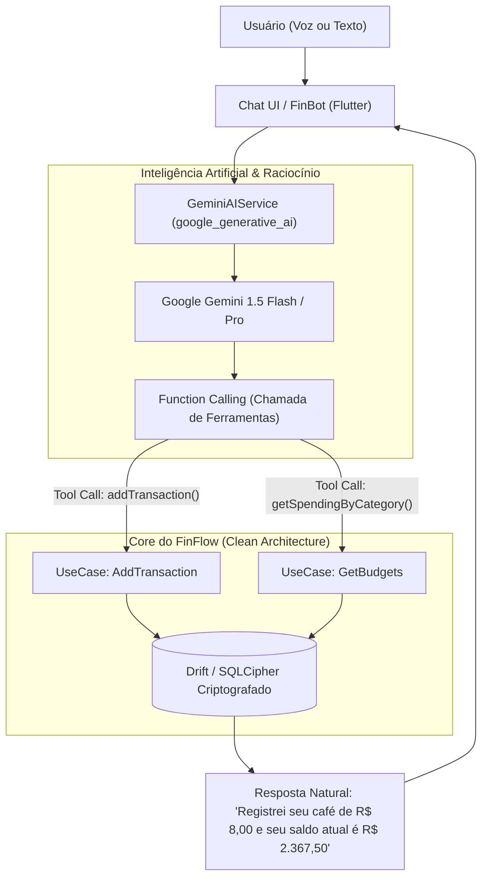

# Arquitetura de Inteligência Artificial: Assistente Virtual no FinFlow

## 1. É Possível Criar um Assistente Virtual Dentro do FinFlow?
**Sim, 100%!** No Flutter, criar um copiloto financeiro inteligente é plenamente viável e representa o ápice da engenharia moderna de aplicativos móveis.

No ecossistema Flutter, o Google mantém o SDK oficial:
👉 **[`google_generative_ai`](https://pub.dev/packages/google_generative_ai)**



---

## 2. Como Funciona na Prática: Function Calling (Tool Calling)

A diferença entre um "chatbot comum" e um **Assistente Virtual de Verdade** está no conceito de **Function Calling**:

A IA não apenas responde perguntas teóricas. Ela tem a capacidade de **executar comandos reais no app**.

### Exemplo do Fluxo de Conversação:
1. **O Usuário digita ou fala:**  
   *"Acabei de almoçar no Centro e gastei 42 reais no cartão."*
2. **O Modelo Gemini analisa o texto e identifica intenção:**  
   Ele percebe que se trata de uma despesa e gera um JSON estruturado de ferramenta:
   ```json
   {
     "name": "addTransaction",
     "arguments": {
       "title": "Almoço no Centro",
       "amountInCents": 4200,
       "type": "expense",
       "category": "food"
     }
   }
   ```
3. **O Flutter executa o caso de uso:**  
   O `AddTransaction(TransactionEntity(...))` é chamado no código Dart. A despesa é salva no banco SQLite criptografado.
4. **O FinBot confirma na interface:**  
   *"Pronto! Registrei R$ 42,00 em alimentação. Você ainda tem R$ 458,00 livres na categoria de Necessidades este mês."*

---

## 3. Segurança e Privacidade (Alinhado com a LGPD e Setor Público)

Ao implementar IA em um app que lida com finanças ou dados governamentais:

1. **Minimização de Dados (Prompt Sanitization):**  
   O app **nunca** envia números de CPF, dados bancários completos ou senhas para a API do Gemini. Ele envia apenas valores e categorias sanitizados necessários para a inferência.
2. **Guarda Segura da API Key:**  
   A chave de acesso à API nunca é commitada no código-fonte nem fica exposta no APK. Ela é protegida pelo `SecureStorageService` no **Android Keystore / iOS Keychain**.
3. **On-Device AI (O Futuro com Gemini Nano):**  
   Com a evolução do Android AICore e Flutter MediaPipe, aparelhos modernos já conseguem rodar modelos locais leves (Gemini Nano) **100% offline**, sem enviar um único byte para a nuvem.

---

## 4. Como Usar Esse Argumento na Secretaria de Estado do RJ

Imagine apresentar para os líderes da Secretaria do Estado:
> *"Em vez de criar aplicativos com 50 menus e páginas complexas onde o cidadão ou o servidor público se perde para achar um contracheque ou emitir uma taxa, o Flutter nos permite integrar um **Assistente Cidadão com IA generativa**. O usuário simplesmente pergunta em linguagem natural: 'Como parcelar o IPVA do meu carro?' ou 'Qual foi meu desconto de previdência este mês?', e a IA consulta as APIs públicas seguras do Estado e responde instantaneamente com links e ações diretas."*

Isso transforma você de estagiário em uma referência de inovação para o time.

