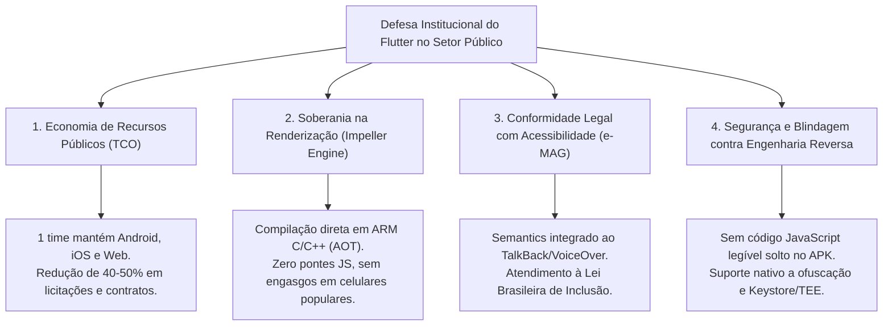

# Dossiê Técnico & Guia de Estudos: Flutter no Setor Público e Arquitetura FinFlow

Este documento serve como sua **base de conhecimento teórica e prática**. Ele conecta o código que construímos no projeto [FinFlow](file:///C:/Users/linke/.gemini/antigravity/scratch/finflow) aos argumentos estratégicos necessários para você dialogar com autoridade com os líderes de tecnologia e gestores da **Secretaria de Estado do Rio de Janeiro**.

---

## 1. Como Defender o Flutter em uma Reunião Técnica no Estado

Quando um gestor ou arquiteto sênior no governo pergunta: *"Por que não fazer Nativo (Kotlin/Swift) ou React Native?"*, sua resposta deve focar em **4 pilares institucionais**:

### Script de Argumentação Rápida (Elevator Pitch Técnico):
> *"No setor público, temos dois grandes desafios: orçamentos de desenvolvimento limitados e uma população que utiliza desde aparelhos topo de linha até celulares Android básicos de entrada.*
> *O Flutter resolve isso na raiz: com uma única base de código em Dart, entregamos para Android e iOS sem comprometer performance, porque ele não usa pontes lentas de JavaScript — ele compila para código de máquina puro (AOT) e desenha cada pixel direto na GPU com a engine Impeller.*
> *Além disso, atendemos às exigências legais de acessibilidade do e-MAG através da árvore nativa de Semantics e garantimos a blindagem exigida pela LGPD com facilidade de integração ao Secure Enclave e Keystore do sistema."*

---

## 2. Conceitos Técnicos Fundamentais do FinFlow (Para Estudar e Dominar)

### 2.1 Por que Valores Monetários são `int` (Centavos) e NUNCA `double`?
- **O Problema do Ponto Flutuante:** Computadores representam números com casas decimais usando o padrão IEEE 754 (base 2). Frações como $0.1$ ou $0.2$ tornam-se dízimas binárias periódicas infinitas, gerando erros sutis de arredondamento:
  $$\text{0.1} + \text{0.2} = \text{0.30000000000000004}$$
- **A Solução Adotada no FinFlow:** Toda a camada de Domínio e Banco de Dados trata dinheiro como **centavos inteiros**:
  - R\$ 10,50 é armazenado e calculado como `1050`.
  - A divisão por 100 ocorre **apenas no momento da renderização visual**.
  - *Em bancos e sistemas fiscais do Estado, qualquer discrepância de 1 centavo gera inconsistência em auditorias contábeis.*

### 2.2 Clean Architecture Feature-First
Ao invés de dividir o projeto apenas por camadas globais (`/models`, `/controllers`, `/views`), organizamos por **Features de Negócio**:
- `lib/features/transactions/`
  - `domain/`: O núcleo puro da aplicação (Entities e UseCases). **Não depende de nenhum framework ou pacote externo de banco de dados.**
  - `data/`: Modelos com parsing JSON/Drift, DataSources locais e a implementação concreta dos repositórios.
  - `presentation/`: Gerenciamento de estado (`TransactionBloc`), telas (`HomePage`) e widgets reutilizáveis.
- **Por que isso importa para a Secretaria?** Permite que múltiplos desenvolvedores ou fornecedores terceirizados trabalhem em módulos independentes sem gerar conflitos contínuos de merge no repositório.

### 2.3 Gerenciamento de Estado Previsível com BLoC
- Diferente de padrões baseados em reatividade solta ou globais onde qualquer parte do código altera variáveis, o **BLoC (Business Logic Component)** segue fluxo estrito:
  $$\text{UI Dispara Evento} \longrightarrow \text{BLoC Executa UseCase} \longrightarrow \text{BLoC Emite Novo Estado Imutável}$$
- **Benefício de Auditoria:** Cada mudança de tela é consequência direta de um estado imutável rastreável. É possível reproduzir qualquer bug gerando uma série sequencial de eventos nos testes unitários com o `bloc_test`.

### 2.4 Injeção de Dependências com Service Locator (`GetIt`)
- Desacopla quem cria um objeto de quem usa o objeto.
- Na [HomePage](file:///C:/Users/linke/.gemini/antigravity/scratch/finflow/lib/features/transactions/presentation/pages/home_page.dart), a tela não instancia o repositório nem o banco SQLite. Ela apenas pede ao `sl<TransactionBloc>()`.
- Isso viabiliza testes automatizados: nos testes, injetamos mocks sem tocar em uma linha da UI.

---

## 3. O Esquadrão Multi-Agente no Antigravity

Os 4 subagentes foram configurados e registrados no ambiente. Cada um possui um escopo específico para você convocar quando necessário:

| Nome do Subagente | Quando Usar |
| :--- | :--- |
| `tech-lead-architect` | Para desenhar novos contratos de API, planejar novas features (ex: Open Finance, exportação de relatórios PDF) e validar integridade arquitetural. |
| `flutter-mobile-engineer` | Para implementar novas telas, animações a 120fps, componentes do Design System e widgets acessíveis. |
| `security-lgpd-officer` | Para auditar vulnerabilidades, desenhar fluxos de criptografia local (Drift + SQLCipher), biometria e conformidade com a LGPD. |
| `scrum-po-lead` | Para criar o planejamento da sprint, escrever User Stories em formato BDD/Gherkin e definir a Definition of Done (DoD). |

### Como acionar os agentes na prática:
Você pode me pedir a qualquer momento instruções como:
- *"Peça ao `scrum-po-lead` para detalhar a Sprint 2 focada em Orçamentos e Metas."*
- *"Acione o `security-lgpd-officer` para desenhar o esquema de banco criptografado com SQLCipher."*
- *"Peça ao `flutter-mobile-engineer` para criar a tela de detalhes de transação com gráficos interativos."*
