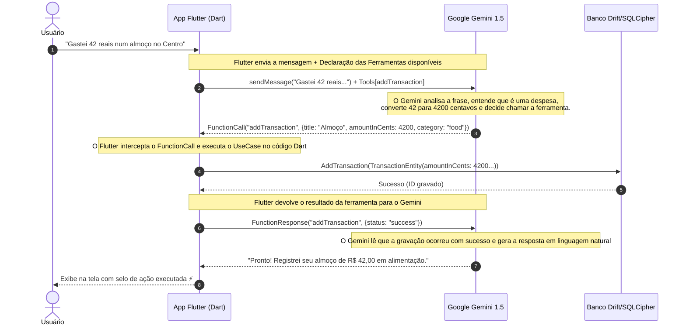

# Guia Completo de Estudos: Google Gemini & Function Calling no Flutter

Este documento foi elaborado para você **estudar, dominar e ter total segurança técnica** ao explicar como Inteligência Artificial Generativa e Chamada de Ferramentas (*Function Calling*) operam dentro de um aplicativo móvel corporativo.

---

## 1. O que é o SDK `google_generative_ai`?

O pacote [`google_generative_ai`](https://pub.dev/packages/google_generative_ai) é a biblioteca oficial mantida pelo time de engenharia da Google para integrar os modelos da família **Gemini** (como o `gemini-1.5-flash` e o `gemini-1.5-pro`) diretamente em aplicações Dart e Flutter.

### Diferença entre uma Chamada HTTP Manual e o SDK Oficial:

| Característica | Chamada HTTP com `dio` ou `http` | SDK Oficial `google_generative_ai` |
| :--- | :--- | :--- |
| **Modelagem de Tipos** | Manipulação manual de `Map<String, dynamic>` e JSONs brutos. | Objetos fortemente tipados (`Content`, `Part`, `Blob`, `Schema`). |
| **Memória de Conversa** | Você precisa concatenar manualmente todo o histórico de mensagens a cada request. | A classe `ChatSession` gerencia o histórico de turnos automaticamente. |
| **Function Calling** | Muito complexo: requer parsing de esquemas OpenAPI na mão. | Nativo via `FunctionDeclaration` e `Tool(functionDeclarations: [...])`. |
| **Streaming de Resposta** | Requer leitura manual de *Server-Sent Events (SSE)*. | Método nativo `model.generateContentStream(...)` reativo. |

---

## 2. O Conceito Chave: O Que é Function Calling (Chamada de Ferramentas)?

Muitos desenvolvedores acreditam erroneamente que *"a inteligência artificial acessa o banco SQLite e grava os dados sozinha"*. **Isso não é verdade e seria uma falha gravíssima de segurança.**

Modelos de linguagem (LLMs) são redes neurais que processam texto. Eles **não têm acesso à memória RAM do celular, nem ao SQLite, nem à câmera**.

### O Ciclo de 4 Etapas do Function Calling:



---

## 3. Anatomia do Código Implementado no FinFlow

Vamos dissecar o código que criamos em [`gemini_ai_remote_datasource.dart`](file:///C:/Users/linke/.gemini/antigravity/scratch/finflow/lib/features/ai_assistant/data/datasources/gemini_ai_remote_datasource.dart):

### 3.1 Declarando a Ferramenta com `FunctionDeclaration`
Aqui ensinamos ao Gemini quais parâmetros nossa função exige e qual o tipo de cada um:

```dart
final addTransactionTool = FunctionDeclaration(
  'addTransaction', // Nome identificador da função
  'Registra uma nova receita ou despesa financeira no banco de dados local do FinFlow.', // Explicação para a IA saber QUANDO usar
  Schema.object(
    properties: {
      'title': Schema.string(description: 'Nome ou estabelecimento da transação'),
      'amountInCents': Schema.integer(description: 'Valor estritamente em centavos inteiros (multiplicar reais por 100)'),
      'type': Schema.string(enumValues: ['expense', 'income']),
      'category': Schema.string(enumValues: ['food', 'transport', 'housing', 'health', 'leisure', 'salary', 'other']),
    },
    requiredProperties: ['title', 'amountInCents', 'type'], // Parâmetros obrigatórios
  ),
);
```

### 3.2 Instrução de Sistema (*System Instruction*)
Damos a persona e as regras inegociáveis para o modelo:

```dart
systemInstruction: Content.system(
  'Você é o FinBot, assistente financeiro do FinFlow. '
  'Quando o usuário informar que gastou ou recebeu dinheiro, execute a ferramenta addTransaction. '
  'Converta sempre reais para centavos inteiros.',
)
```

### 3.3 Interceptando e Executando a Ferramenta no Dart
Quando o Gemini devolve `response.functionCalls`, o Flutter assume o comando:

```dart
final functionCalls = response.functionCalls.toList();
if (functionCalls.isNotEmpty) {
  for (final call in functionCalls) {
    if (call.name == 'addTransaction') {
      // 1. Extrai os argumentos que a IA estruturou
      final title = call.args['title'] as String;
      final amountInCents = call.args['amountInCents'] as int;

      // 2. Chama a regra de negócio segura da Clean Architecture
      await addTransactionUseCase(TransactionEntity(
        id: const Uuid().v4(),
        title: title,
        amountInCents: amountInCents,
        type: TransactionType.expense,
        category: TransactionCategory.food,
        date: DateTime.now(),
      ));

      // 3. Notifica o modelo que a ferramenta concluiu com êxito
      response = await _chatSession.sendMessage(
        Content.functionResponse('addTransaction', {'status': 'success'}),
      );
    }
  }
}
```

---

## 4. Segurança, LGPD e Melhores Práticas Corporativas

### 4.1 Onde guardar a API Key do Gemini?
1. **Em Desenvolvimento Local:** Pode ser passada via `--dart-define=GEMINI_API_KEY=sua_chave` no comando de build ou resgatada de forma criptografada pelo nosso [`SecureStorageService`](file:///C:/Users/linke/.gemini/antigravity/scratch/finflow/lib/core/security/secure_storage_service.dart) (Keystore no Android e Keychain no iOS).
2. **Em Produção Governamental / Corporativa:** O aplicativo móvel **nunca** deve conter uma chave mestre embutida no binário. A recomendação sênior é usar um **BFF (Backend-for-Frontend)**: o app chama sua API segura no servidor do Estado, o servidor valida o token do usuário e despacha a chamada ao Gemini com a chave protegida no cofre de segredos do datacenter.

### 4.2 Minimização e Privacidade de Dados
- **Regra de Ouro:** Não envie identificadores pessoais (CPF, RG, nome completo, número de conta) para o prompt da IA. Envie apenas a frase da transação e os valores estritamente necessários para a classificação.

---

## 5. Como Apresentar e Defender Esse Conhecimento

Se em uma conversa na Secretaria ou em uma entrevista técnica perguntarem:
> *"Qual a diferença entre colocar um chat comum com LLM e uma arquitetura com Function Calling?"*

**Sua resposta de alto nível:**
> *"Um chatbot comum apenas gera texto desconectado da aplicação — ele responde o que é uma despesa, mas não consegue agir. Com Function Calling, a IA se torna uma camada de interface em linguagem natural para as regras de negócio do sistema.*
> *Nós expomos esquemas rígidos de funções Dart com tipagem forte e validação. O modelo de IA atua como um tradutor semântico que interpreta a intenção do usuário e aciona os UseCases internos da nossa Clean Architecture, mantendo a integridade do banco de dados relacional e a total conformidade com a LGPD."*
