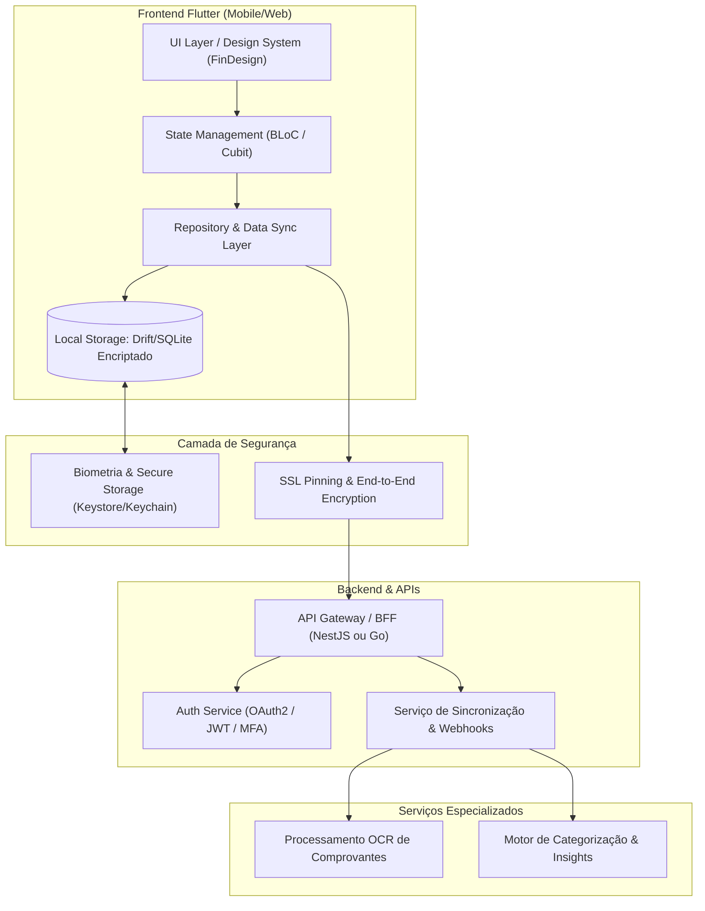
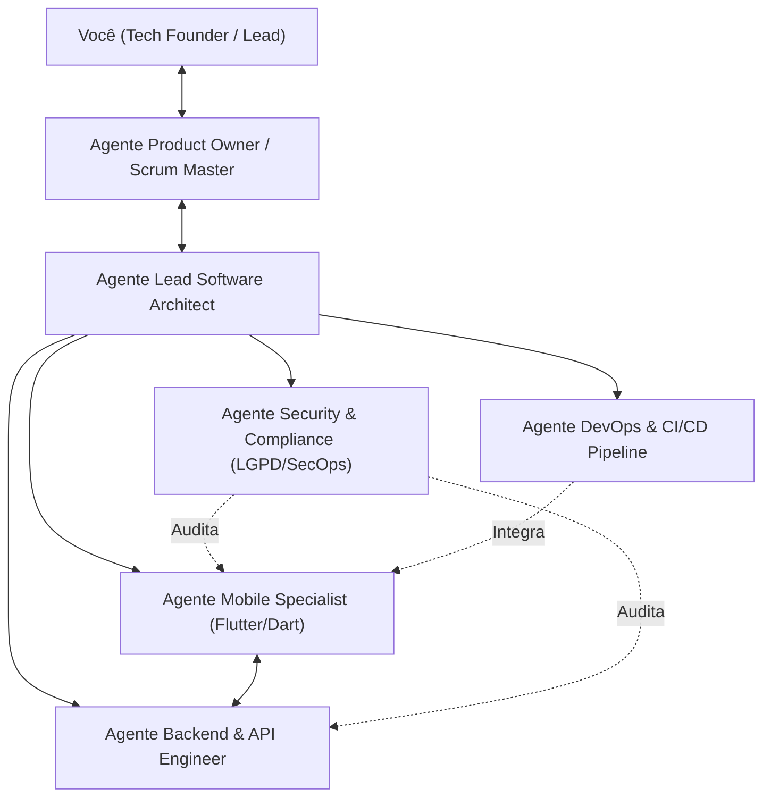
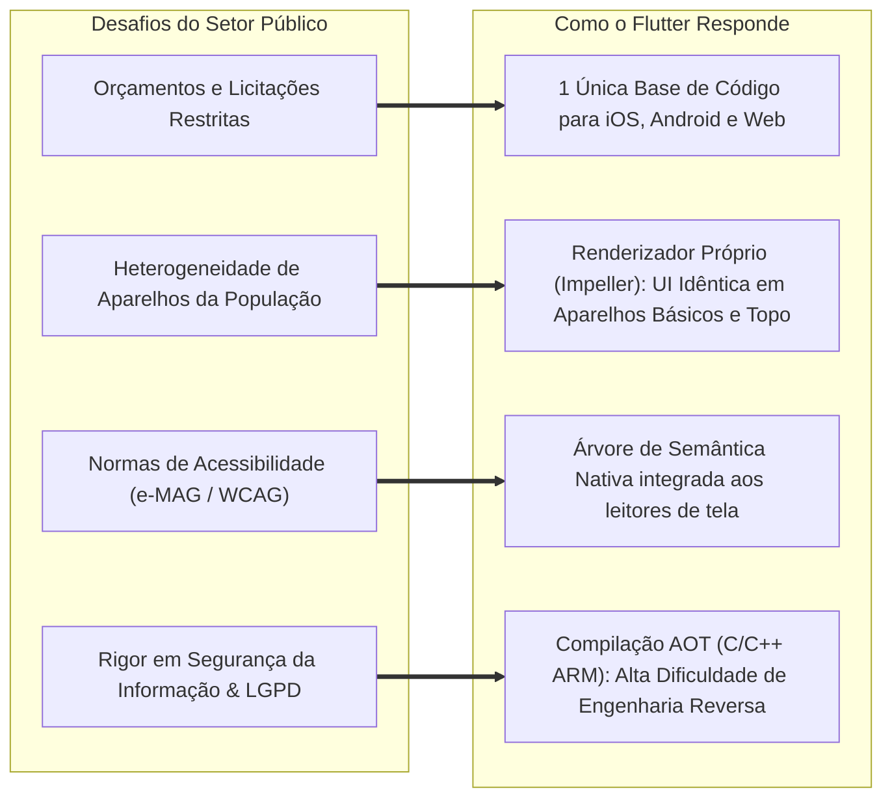

# Master Blueprint: App de Gestão Financeira E2E & Esquadrão Multi-Agente

Este documento consolida a visão integral do projeto: desde a arquitetura de engenharia do aplicativo financeiro até o modelo operacional com agentes autônomos no Antigravity e a defesa técnica do Flutter voltada ao setor público (Secretaria de Estado do RJ).

---

## 1. Visão Geral do Produto (App de Finanças Pessoais)

### 1.1 Proposta de Valor
Um ecossistema financeiro multiplataforma, offline-first, seguro e com inteligência analítica para controle de receitas, despesas, orçamentos (metas 50/30/20), investimentos básicos e leitura automatizada de extratos/comprovantes.

### 1.2 Módulos E2E do Sistema
1. **Core Financeiro:**
   - Gestão de transações (receitas, despesas fixas/variáveis, parcelamentos).
   - Multi-contas (corrente, poupança, carteira física, cartões de crédito).
   - Fechamento e previsão de faturas de cartão com simulador de juros.
2. **Orçamento e Metas:**
   - Divisão orçamentária automática (ex: regra 50/30/20).
   - Metas financeiras com projeção de tempo de conquista e aportes recomendados.
3. **Automação e IA:**
   - Leitura de comprovantes e notas fiscais por OCR (extração de valor, data e estabelecimento).
   - Categorização preditiva baseada no histórico de gastos.
4. **Segurança de Nível Bancário:**
   - Autenticação biométrica obrigatória para transações críticas.
   - Criptografia local com SQLCipher/Drift para funcionamento 100% offline seguro.
   - Detecção de Jailbreak/Root e bloqueio de capturas de tela em áreas sensíveis.

---

## 2. Esquadrão Multi-Agente no Antigravity

Para conduzir o desenvolvimento como um time sênior de engenharia, organizamos agentes especializados com papéis estritos. Cada agente atua com foco em boas práticas de mercado e conformidade enterprise:

### 2.1 Papéis e Responsabilidades dos Agentes

| Agente | Responsabilidade Principal | Ferramental / Foco |
| :--- | :--- | :--- |
| **Scrum Master & PO** | Backlog, épicos, critérios de aceite (Gherkin), priorização por valor de negócio. | Jira-style specs, documentação de histórias de usuário e DoD (Definition of Done). |
| **Lead Architect** | Definição de padrões de arquitetura (Clean Architecture, Feature-First), contratos de API (OpenAPI/Swagger) e resolução de trade-offs. | Diagramas C4, ADRs (Architectural Decision Records), RFCs internas. |
| **Flutter Specialist** | Implementação de UI/UX, BLoC, gerenciamento de estado previsível, testes unitários e de widget, fluidez 60/120fps. | Flutter SDK, Dart 3, Melos (se monorepo), Design System com tokens. |
| **Backend Engineer** | APIs resilientes, regras de negócio bancárias, concorrência, idempotência e modelagem de dados. | NestJS/TypeScript ou Go, PostgreSQL, Redis, Docker, testes de integração. |
| **Security & LGPD** | Criptografia em repouso e trânsito, sanitização de inputs, adequação à LGPD, threat modeling e auditoria de dependências. | OWASP Mobile Top 10, SQLCipher, KeyStore/KeyChain, Trivy/Dependabot. |
| **DevOps & QA** | Pipelines de build automatizados, testes E2E (Patrol/Integration Tests), distribuição automatizada (Fastlane/GitHub Actions). | GitHub Actions, Fastlane, SonarQube, Docker. |

---

## 3. Dossiê Técnico: Por que Flutter para a Secretaria de Estado do RJ?

> [!IMPORTANT]
> Este argumento é construído sob a ótica da **Administração Pública**: eficiência de gastos públicos, segurança jurídica/LGPD, longevidade tecnológica, inclusão e manutenibilidade.

### 3.1 Argumentos Chave para Apresentação Institucional

1. **Eficiência no Uso de Recursos Públicos (Single Codebase Real):**
   - No modelo tradicional nativo (Kotlin + Swift), o Estado precisa licitar ou contratar duas equipes de engenheiros móveis distintas, duplicando custos de desenvolvimento, testes e sustentação.
   - Com Flutter, **uma única equipe mantém iOS, Android e até Web/Desktop**. A redução do custo total de propriedade (TCO) chega a 40-50%.

2. **Desempenho e Consistência Visual em Aparelhos Populares:**
   - O cidadão do Rio de Janeiro usa desde celulares topo de linha até aparelhos de entrada com Android legado.
   - Ao contrário de frameworks baseados em pontes JavaScript (como versões legadas de React Native ou híbridos webview), o Flutter compila diretamente para **código de máquina ARM nativo (Ahead-Of-Time - AOT)** e desenha cada pixel diretamente na GPU através da engine **Impeller**. Isso elimina engasgos (jank) mesmo em smartphones populares.

3. **Conformidade com Acessibilidade Pública (e-MAG e WCAG):**
   - O setor público tem o dever legal de acessibilidade (Lei Brasileira de Inclusão nº 13.146/2015).
   - O Flutter possui um sistema nativo de `Semantics` que se integra perfeitamente aos serviços de acessibilidade do sistema operacional (TalkBack no Android e VoiceOver no iOS), facilitando auditorias de conformidade do Estado.

4. **Segurança e LGPD (Blindagem de Aplicações do Estado):**
   - Por ser compilado em binário nativo C/C++ sem arquivos JavaScript ou bytecode legível soltos no pacote APK/IPA, o Flutter torna a engenharia reversa e a extração de dados sensíveis muito mais complexa.
   - Suporte maduro a ofuscação de código no build de produção (`--obfuscate --split-debug-info`), SSL Pinning e integração direta com módulos criptográficos seguros do hardware (TEE / Secure Enclave).

5. **Casos de Sucesso Governamentais e Corporativos:**
   - Bancos digitais (ex: Nubank migrou quase todo o app para Flutter) comprovam robustez para operações financeiras críticas de alta escala.
   - Diversas entidades governamentais globais e nacionais já adotam Flutter pela facilidade de criar Design Systems padronizados e reutilizáveis entre secretarias.

---

## 4. Trilha Integrada: Desenvolvimento & Aprendizado Prático

Para você absorver a teoria enquanto constrói o portfólio prático, dividimos a jornada em 4 fases incrementais:

### Fase 1: Arquitetura & Fundamentos de Engenharia
- **Prática:** Configuração do projeto Flutter com arquitetura em camadas (*Feature-First Clean Architecture*), injeção de dependência (`get_it`), e gerenciamento de estado com `flutter_bloc`.
- **Estudo Teórico:**
  - Ciclo de vida de widgets e render tree (Widget, Element, RenderObject).
  - Padrão BLoC vs Riverpod: por que BLoC é preferido em ambientes corporativos e bancários (imutabilidade, rastreabilidade e facilidade de testes de fluxo).
  - Tipagem forte e padrões funcionais do Dart 3 (Records, Pattern Matching, Sealed Classes).

### Fase 2: Segurança, Dados e Funcionamento Offline
- **Prática:** Criação da base de dados local criptografada com `drift` + `sqlcipher`, camadas de repositório com sincronização automática e controle biométrico (`local_auth`).
- **Estudo Teórico:**
  - Como funciona a criptografia simétrica AES-256 e o gerenciamento de chaves via Keystore (Android) e Keychain (iOS).
  - Estratégias de cache e sincronização offline-first (resolução de conflitos de dados de despesas criadas sem internet).
  - Fundamentos da LGPD aplicados ao desenvolvimento móvel (minimização de dados, consentimento e logs de auditoria).

### Fase 3: Backend, Integrações e Automação Inteligente
- **Prática:** Desenvolvimento de API Restful/gRPC protegida com JWT/OAuth2, serviço de leitura de faturas/comprovantes com OCR e categorização automática.
- **Estudo Teórico:**
  - Modelagem de domínio financeiro: prevenção de erros de ponto flutuante (uso estrito de inteiros em centavos ou tipos `Decimal`), concorrência e transações atômicas ACID.
  - Segurança de APIs: Rate limiting, CORS, proteção contra CSRF e validação estrita de esquemas.

### Fase 4: DevOps, Testes Automatizados e Pitch Institucional
- **Prática:** Pipeline de CI/CD via GitHub Actions (linting, testes unitários, testes de widget e geração automatizada de APK/AAB assinado).
- **Estudo Teórico:**
  - Pirâmide de testes no mobile: Testes Unitários de Bloc, Testes de Widget e Testes E2E com Patrol.
  - Como elaborar e defender um estudo de viabilidade técnica (Documento de Proposta de Inovação) para a gestão da Secretaria de Estado.

---

## 5. Próximos Passos Imediatos

1. **Inicialização do Workspace:** Criar a estrutura do repositório no diretório de projetos.
2. **Definição dos Agentes no Antigravity:** Criar formalmente os subagentes especializados para que cada um responda em seu domínio.
3. **Especificação do MVP (Sprint 1):** O Agente PO estruturar as primeiras histórias de usuário do Módulo Core (Cadastro de despesas/receitas offline com criptografia).
