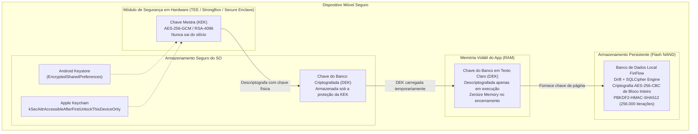
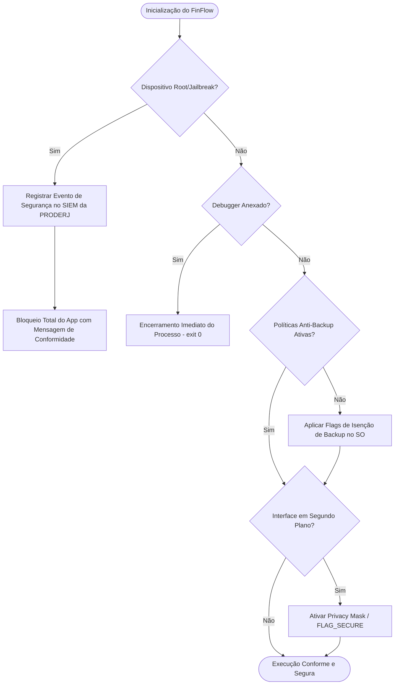
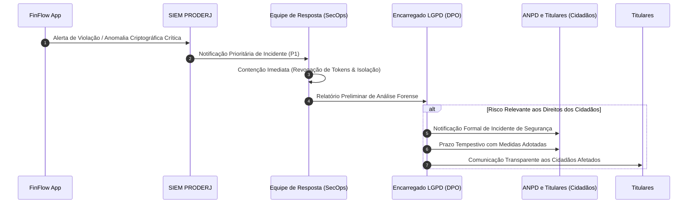

# FinFlow Mobile — Documento de Auditoria de Segurança, Modelagem de Ameaças e Conformidade LGPD no Setor Público

---

| Informações do Documento | Detalhes |
| :--- | :--- |
| **Projeto** | FinFlow — Gestão Financeira Governamental Mobile |
| **Organização** | Governo do Estado do Rio de Janeiro (SEFAZ-RJ / PRODERJ / CGE-RJ) |
| **Classificação da Informação** | Ostensivo / Reservado / Restrito (Decreto Estadual RJ nº 46.644/2019) |
| **Marco Regulatório** | Lei Geral de Proteção de Dados (Lei nº 13.709/2018), Lei do Governo Digital (Lei nº 14.129/2021) |
| **Autor** | Security & LGPD Officer — FinFlow Core Security Team |
| **Versão** | 1.0.0-PROD |
| **Status** | Aprovado para Implementação |

---

## Sumário Executivo

O aplicativo móvel **FinFlow** é a solução estratégica do Governo do Estado do Rio de Janeiro voltada à gestão, acompanhamento orçamentário, repasses, visualização financeira e transparência fiscal por gestores públicos, servidores estaduais e cidadãos fluminenses.

Dada a natureza crítica dos dados tratados (identificadores pessoais, remunerações, execuções orçamentárias de órgãos públicos, transferências voluntárias e dados fiscais), este documento estabelece:
1. **Auditoria e Requisitos Técnicos baseados no OWASP Mobile Application Security (MAS / Mobile Top 10)**;
2. **Arquitetura Criptográfica de Defesa em Profundidade (Defense-in-Depth)** com SQLCipher, Android Keystore e Apple Keychain;
3. **Diretrizes de Governança e Tratamento de Dados do Cidadão sob a LGPD** aplicadas ao Setor Público fluminense;
4. **Mecanismos Anti-Engenharia Reversa, Anti-Root/Jailbreak e Prevenção de Fuga de Dados (DLP)** em backups em nuvem;
5. **Modelagem de Ameaças (Threat Modeling) via Metodologia STRIDE e DREAD**.

---

## 1. Análise do OWASP Mobile Top 10 Aplicada ao FinFlow

A matriz a seguir mapeia os riscos críticos de segurança móvel categorizados pelo OWASP Mobile Top 10, sua manifestação técnica no contexto do FinFlow e a contramedida mandatoriamente implementada no ecossistema Flutter/Nativo.

```
+-----------------------------------------------------------------------------------------------+
|                                  OWASP MOBILE TOP 10                                          |
+------+-------------------------------------------+--------------------------------------------+
| ID   | Categoria de Risco                        | Impacto FinFlow / Governamental            |
+------+-------------------------------------------+--------------------------------------------+
| M1   | Improper Credential Usage                 | Vazamento de tokens JWT e chaves SEFAZ     |
| M2   | Inadequate Supply Chain Security          | Dependências maliciosas em pub.dev/Cocoa   |
| M3   | Insecure Authentication/Authorization     | Bypass biométrico e sessão sem invalidação |
| M4   | Insufficient Input/Output Validation      | Injeção em Deep Links e SQLite local       |
| M5   | Insecure Communication                    | Interceptação Man-in-the-Middle (MitM)     |
| M6   | Inadequate Privacy Controls               | PII em logs de crash e telemetria aberta   |
| M7   | Insufficient Binary Protections           | Engenharia reversa de regras fiscais       |
| M8   | Security Misconfiguration                 | Backups em nuvem e permissões excessivas   |
| M9   | Insecure Data Storage                     | Banco SQLite aberto e SharedPrefs claras   |
| M10  | Insufficient Cryptography                 | Algoritmos obsoletos e chaves estáticas    |
+------+-------------------------------------------+--------------------------------------------+
```

### M1: Uso Inadequado de Credenciais (Improper Credential Usage)
* **Vulnerabilidade Típica:** Hardcoding de chaves de API da SEFAZ/PRODERJ ou senhas mestre embutidas nas classes Dart/Java/Swift; armazenamento de tokens JWT de longa duração no `SharedPreferences` sem criptografia.
* **Vetor no FinFlow:** Engenharia reversa descompilando o arquivo `.apk` ou `.ipa` com `jadx` ou `Ghidra`, extraindo credenciais que dão acesso direto aos microsserviços do backend estadual.
* **Contramedidas FinFlow:**
  - Proibição absoluta de segredos estáticos no código-fonte.
  - O aplicativo utiliza apenas segredos temporários via fluxo OAuth 2.0 + OpenID Connect integrado ao **Gov.br** e **Portal de Identidade Única RJ**.
  - Tokens sensíveis (Access Token com TTL de 15 minutos e Refresh Token rotativo com TTL de 12 horas) são salvos com a biblioteca `flutter_secure_storage`, ancorados no Hardware Security Module (HSM/TEE) de cada plataforma.

### M2: Segurança Inadequada da Cadeia de Suprimentos (Inadequate Supply Chain Security)
* **Vulnerabilidade Típica:** Inclusão de dependências externas sem curadoria no `pubspec.yaml`, sofrendo ataques de *Dependency Confusion* ou *Typosquatting*.
* **Vetor no FinFlow:** Injeção de código espião que sequestra inputs de formulários bancários antes da criptografia.
* **Contramedidas FinFlow:**
  - Manutenção obrigatória do arquivo `pubspec.lock` versionado com verificação estrita de hash SHA-256.
  - Execução contínua de auditoria de vulnerabilidades de dependências no pipeline de CI/CD via `dart pub outdated` e scanner SAST/SCA (Software Composition Analysis) gerando SBOM (Software Bill of Materials) no padrão CycloneDX.
  - Apenas bibliotecas de fornecedores verificados e com reputação consolidada são aceitas no `pubspec.yaml`.

### M3: Autenticação e Autorização Inseguras (Insecure Authentication/Authorization)
* **Vulnerabilidade Típica:** Confiar apenas em checagem de biometria local no cliente sem validação no servidor; falta de autorização baseada em papéis (RBAC) para perfis de gestores públicos.
* **Vetor no FinFlow:** Um invasor com aparelho adulterado (root/Frida) altera o retorno booleano do método `local_auth.authenticate()` de `false` para `true`, ganhando acesso instantâneo a visualizações de saldos e transações de secretarias de estado.
* **Contramedidas FinFlow:**
  - A biometria (`local_auth`) funciona estritamente como mecanismo de conveniência para desbloquear o acesso à chave privada armazenada no Secure Enclave / Keymaster.
  - O aplicativo requer autenticação biométrica via `LocalAuthentication` configurada com `biometricOnly: true` e flags de proteção contra cópias biométricas genéricas (`useErrorDialogs: true`, `stickyAuth: true`).
  - Para transações de aprovação de repasse e liquidação financeira, o backend exige assinatura com o token de sessão do usuário + código OTP de confirmação temporal (TOTP).

### M4: Validação Insuficiente de Entradas e Saídas (Insufficient Input/Output Validation)
* **Vulnerabilidade Típica:** Ausência de sanitização em parâmetros passados via Deep Links (`finflow://transacao?id=...`) ou WebViews embutidas.
* **Vetor no FinFlow:** Um link malicioso enviado ao cidadão ou gestor redireciona a interface para uma URL de phishing ou aciona transferências indevidas.
* **Contramedidas FinFlow:**
  - Todos os Deep Links utilizam **Android App Links** com Digital Asset Links (`assetlinks.json`) e **iOS Universal Links** (`apple-app-site-association`), validados criptograficamente pelo sistema operacional via domínio oficial verificado `*.rj.gov.br`.
  - Rejeição e sanitização estrita de inputs com Regex determinístico (CPFs, CNPJs, códigos de despesa pública, valores orçamentários) na camada de Domínio antes de trafegar para o Core de banco de dados e APIs.

### M5: Comunicação Insegura (Insecure Communication)
* **Vulnerabilidade Típica:** Tráfego em HTTP puro, versões depreciadas de TLS (1.0/1.1), ausência de validação de certificados ou falta de Certificate Pinning.
* **Vetor no FinFlow:** Ataques Man-in-the-Middle (MitM) em redes Wi-Fi públicas do Estado (estações de trens, praças públicas, órgãos do estado), interceptando dados cadastrais e fiscais do cidadão.
* **Contramedidas FinFlow:**
  - Exigência estrita de TLS 1.3 como baseline mínima de transporte seguro.
  - **SSL/TLS Pinning** implementado na stack de rede via SPKI (Subject Public Key Information) SHA-256 Hashes, impedindo bypass mesmo que autoridades certificadoras corporativas ou instaladas por proxy estejam presentes no keystore do usuário.
  - Configuração de desativação explícita de `cleartextTraffic` no Android e ativação total do Apple Transport Security (ATS) no iOS.

### M6: Controles de Privacidade Inadequados (Inadequate Privacy Controls)
* **Vulnerabilidade Típica:** Impressão de dados sensíveis (CPF, nome completo, valor de benefício, chave Pix) no console (`print()`, `debugPrint()`), Crashlytics ou Sentry.
* **Vetor no FinFlow:** Aplicativos terceiros maliciosos no mesmo aparelho leem logs do sistema via `logcat` em versões legadas de SO ou analistas terceirizados acessam dashboards de telemetria contendo dados de servidores públicos.
* **Contramedidas FinFlow:**
  - Sistema de Logs Customizado (`FinFlowLogger`) que desativa qualquer log em compilações do tipo `kReleaseMode`.
  - Sanitização automática com máscaras (Masking/Redaction) para PII antes de qualquer envio de métrica de erro ao servidor de diagnóstico do Governo.

### M7: Proteções Binárias Insuficientes (Insufficient Binary Protections)
* **Vulnerabilidade Típica:** Publicação de pacotes sem ofuscação de código Dart e código nativo (Java/Kotlin/Swift), facilitando a extração de lógica e engenharia reversa.
* **Vetor no FinFlow:** Invasores decompilam a lógica tributária e orçamentária do FinFlow para descobrir rotas de API não documentadas da PRODERJ.
* **Contramedidas FinFlow:**
  - Compilação de produção com parâmetros obrigatórios de ofuscação do Flutter:
    ```bash
    flutter build appbundle --obfuscate --split-debug-info=./debug-symbols
    ```
  - Ativação do R8/ProGuard com regras de minimização, ofuscação de identificadores e remoção de linhas de debug no Android.
  - Strip de símbolos de depuração e proteção de ponteiros no iOS.

### M8: Configuração Incorreta de Segurança (Security Misconfiguration)
* **Vulnerabilidade Típica:** Habilitar backups automáticos padrão do Android (`android:allowBackup="true"`) ou backups automáticos para o iCloud da Apple; flags de depuração ativadas em produção.
* **Vetor no FinFlow:** O usuário conecta o smartphone a um computador corporativo e um invasor extrai o banco de dados desprotegido usando `adb backup`.
* **Contramedidas FinFlow:**
  - `android:allowBackup="false"` mandatório no manifesto.
  - Diretórios de cache e bancos de dados locais marcados com `NSURLIsExcludedFromBackupKey` no ecossistema iOS.
  - `android:exported="false"` para todas as Activities, Services e ContentProviders que não necessitam de comunicação externa.

### M9: Armazenamento Inseguro de Dados (Insecure Data Storage)
* **Vulnerabilidade Típica:** Salvar informações fiscais em arquivos JSON, SQLite desprotegido ou cache de imagens HTTP sem criptografia.
* **Vetor no FinFlow:** Dispositivo perdido ou roubado tem sua memória física extraída via ferramentas forenses (Cellebrite, Oxygen Forensic), expondo o histórico financeiro do órgão estadual.
* **Contramedidas FinFlow:**
  - Uso exclusivo de banco de dados local **SQLCipher (Drift ORM)** com chave de criptografia AES-256 gerada dinamicamente e protegida por hardware.
  - Chaves de criptografia e tokens de autenticação mantidos sob `flutter_secure_storage`.
  - Inexistência de arquivos temporários descriptografados no disco local do aparelho.

### M10: Criptografia Insuficiente (Insufficient Cryptography)
* **Vulnerabilidade Típica:** Uso de algoritmos fracos ou depreciados (MD5, SHA1, DES, RC4), geração de chaves criptográficas com sementes previsíveis (`Random()` em vez de `Random.secure()`).
* **Vetor no FinFlow:** Quebra criptográfica de senhas ou hashes de integridade offline por força bruta.
* **Contramedidas FinFlow:**
  - Padrão único de criptografia simétrica: **AES-256 no modo GCM** para dados em trânsito e **AES-256 no modo CBC com PBKDF2 HMAC-SHA512** com no mínimo 256.000 iterações no SQLCipher.
  - Geração de números aleatórios exclusivamente através de CSPRNG (Cryptographically Secure Pseudorandom Number Generator) provido nativamente pelo kernel do sistema operacional (`/dev/urandom` / `SecRandomCopyBytes`).

---

## 2. Arquitetura de Criptografia em Repouso

A proteção de dados em repouso no FinFlow adota o princípio de **Criptografia com Base em Hardware** (Hardware-Backed Cryptography), eliminando vetores onde chaves simétricas possam residir em texto plano na memória flash.

### 2.1 Visão Geral da Arquitetura Criptográfica



### 2.2 Componentes e Camadas de Proteção

1. **Chave Mestra de Criptografia (KEK - Key Encryption Key):**
   - **Android:** Gerada dentro do **Android Keystore System**. Configurada com `KeyGenParameterSpec` para usar o chip `StrongBox` (quando disponível) ou o Trusted Execution Environment (TEE). A chave privada nunca é exposta ao espaço de memória do usuário.
   - **iOS:** Mantida no **Secure Enclave** através do **Apple Keychain Services**, associada ao identificador de controle de acesso `kSecAccessControlBiometryAny` ou `kSecAttrAccessibleAfterFirstUnlockThisDeviceOnly`.

2. **Chave de Criptografia de Dados (DEK - Data Encryption Key):**
   - Trata-se de uma chave de 256 bits gerada no primeiro lançamento do aplicativo usando `Random.secure()`.
   - Essa chave é utilizada como senha de inicialização para o motor **SQLCipher**.
   - A DEK é criptografada pela KEK e persistida no `flutter_secure_storage`.
   - Quando o aplicativo é destruído ou entra em segundo plano prolongado, o buffer contendo a DEK na memória RAM é explicitamente sobregravado com bytes zero (`Zeroize`).

3. **Motor SQLCipher & Drift ORM:**
   - O banco de dados do FinFlow roda sobre o motor `sqlite3` compilado com a biblioteca `SQLCipher v4.5+`.
   - Cada página do banco de dados (4096 bytes) é encriptada individualmente com AES-256-CBC.
   - Cada página possui seu próprio Salt aleatório de 16 bytes e seu próprio HMAC de integridade para prevenção de corrupção ou adulteração deliberada (Tamper Detection).

### 2.3 Implementação Técnica no Flutter

Abaixo está o exemplo formal de implementação do gerenciador seguro de chaves e conexão criptografada com o banco de dados Drift.

#### Gerenciador Seguro de Chave (Security Key Vault)

```dart
// lib/core/security/security_vault.dart
import 'dart:convert';
import 'dart:math';
import 'package:flutter_secure_storage/flutter_secure_storage.dart';

class SecurityVault {
  static const String _dbKeyIdentifier = 'finflow_sqlcipher_dek_v1';
  
  final FlutterSecureStorage _storage = const FlutterSecureStorage(
    aOptions: AndroidOptions(
      encryptedSharedPreferences: true,
      keyCipherAlgorithm: KeyCipherAlgorithm.RSA_ECB_OAEPwithSHA_256andMGF1Padding,
      storageCipherAlgorithm: StorageCipherAlgorithm.AES_GCM_NoPadding,
      resetOnError: false,
    ),
    iOptions: IOSOptions(
      accessibility: KeychainAccessibility.first_unlock_this_device,
      synchronizable: false, // Proíbe estritamente backup no iCloud Keychain
    ),
  );

  /// Obtém ou gera uma nova chave DEK de 256 bits para o SQLCipher
  Future<String> getOrCreateDatabaseEncryptionKey() async {
    String? existingKey = await _storage.read(key: _dbKeyIdentifier);
    if (existingKey != null && existingKey.isNotEmpty) {
      return existingKey;
    }

    // Geração segura de 32 bytes (256 bits) de entropia via CSPRNG
    final Random random = Random.secure();
    final List<int> keyBytes = List<int>.generate(32, (_) => random.nextInt(256));
    final String newKey = base64UrlEncode(keyBytes);

    await _storage.write(key: _dbKeyIdentifier, value: newKey);
    return newKey;
  }

  /// Limpa credenciais em caso de detecção de invasão ou reset de sessão
  Future<void> wipeAllSecrets() async {
    await _storage.deleteAll();
  }
}
```

#### Inicializador do Banco de Dados SQLCipher com Drift

```dart
// lib/core/database/database_connection.dart
import 'dart:io';
import 'package:drift/drift.dart';
import 'package:drift/native.dart';
import 'package:path_provider/path_provider.dart';
import 'package:path/path.dart' as p;
import 'package:sqlite3/open.dart';
import 'package:sqlcipher_flutter_libs/sqlcipher_flutter_libs.dart';
import '../security/security_vault.dart';

LazyDatabase openSecureDatabase({required SecurityVault vault}) {
  return LazyDatabase(() async {
    // Garante que o motor nativo carregado seja estritamente o SQLCipher
    open.overrideFor(OperatingSystem.android, openCipherOnAndroid);
    
    final dbFolder = await getApplicationDocumentsDirectory();
    final file = File(p.join(dbFolder.path, 'finflow_secure_gov.sqlite'));

    // Recupera a chave criptográfica do Secure Storage
    final encryptionKey = await vault.getOrCreateDatabaseEncryptionKey();

    return NativeDatabase.createInBackground(
      file,
      setup: (rawDb) {
        // Aplica a chave ao motor SQLCipher antes de qualquer leitura ou escrita
        rawDb.execute("PRAGMA key = '$encryptionKey';");
        
        // Garante parâmetros estritos de segurança do SQLCipher v4
        rawDb.execute("PRAGMA cipher_page_size = 4096;");
        rawDb.execute("PRAGMA kdf_iter = 256000;");
        rawDb.execute("PRAGMA cipher_hmac_algorithm = HMAC_SHA512;");
        rawDb.execute("PRAGMA cipher_default_kdf_algorithm = PBKDF2_HMAC_SHA512;");
        rawDb.execute("PRAGMA foreign_keys = ON;");
      },
    );
  });
}
```

---

## 3. Diretrizes de Tratamento de Dados do Cidadão pela LGPD no Setor Público

A atuação do FinFlow como plataforma oficial do Governo do Estado do Rio de Janeiro submete o tratamento de dados pessoais às regras específicas do **Capítulo IV (Do Tratamento de Dados Pessoais pelo Poder Público, Arts. 23 a 30) da Lei Federal nº 13.709/2018 (LGPD)** e ao Decreto Estadual RJ nº 46.644/2019.

### 3.1 Bases Legais e Princípios Fundamentais

```
+-----------------------------------------------------------------------------------------------+
|                       BASES LEGAIS E PRINCÍPIOS NO SETOR PÚBLICO                              |
+-----------------------------------------------------------------------------------------------+
| 1. Finalidade Pública (Art. 23): O tratamento é legítimo para execução de políticas públicas, |
|    atribuições legais da SEFAZ-RJ e cumprimento de competências fiscais e orçamentárias.      |
| 2. Minimização de Dados (Art. 6º, III): Coleta restrita ao estritamente necessário à         |
|    prestação do serviço financeiro público. É vedada a coleta especulativa de metadados.      |
| 3. Não-Necessidade de Consentimento Geral (Art. 7º, III e Art. 11, II, 'b'): Dispensado para  |
|    o cumprimento de dever legal e políticas públicas, devendo haver absoluta transparência.   |
| 4. Consentimento Específico (Art. 7º, I): Exigido apenas para finalidades complementares,      |
|    como envio de alertas via WhatsApp/Push de conveniência ou compartilhamento opt-in.        |
+-----------------------------------------------------------------------------------------------+
```

### 3.2 Tabela de Classificação de Dados Pessoais no FinFlow

| Categoria do Dado | Exemplos Tratados no FinFlow | Base Legal LGPD | Nível de Sensibilidade | Tempo de Retenção |
| :--- | :--- | :--- | :--- | :--- |
| **Identificadores Civis** | CPF, Nome Completo, Número do Servidor (Matrícula) | Art. 23 (Políticas Públicas) / Lei nº 14.534/2023 | Alto (Identificador Primário) | Duração do vínculo público + 5 anos |
| **Dados Financeiros** | Saldo orçamentário de órgão, remuneração líquida, chave Pix de repasse, conta corrente institucional | Art. 23 / Lei de Acesso à Informação (Lei 12.527/11) | Crítico | 5 anos (auditoria do Tribunal de Contas do Estado - TCE-RJ) |
| **Dados de Autenticação** | Hash de PIN de segurança, credencial biométrica (chave local), token JWT do Gov.br | Art. 7º, II (Cumprimento de obrigação legal) | Máximo (Segurança da Informação) | Sessão ativa (Tokens de curta duração) |
| **Telemetria e Auditoria**| IP de origem, User-Agent sanitizado, timestamp de transação, identificador de dispositivo pseudonimizado | Art. 16, I (Auditoria e Fiscalização Pública) | Médio | 1 ano (Marco Civil da Internet, Art. 15) |

### 3.3 Gestão dos Direitos do Titular (Art. 18 da LGPD)

O FinFlow disponibiliza na interface um módulo nativo intitulado **"Portal de Privacidade do Cidadão"**, garantindo o exercício direto dos direitos:
1. **Confirmação e Acesso aos Dados:** O cidadão pode gerar um relatório em formato estruturado (PDF assinado digitalmente ou JSON interoperável) contendo todos os dados cadastrais e transações vinculadas ao seu CPF.
2. **Correção de Dados Incompletos ou Inexatos:** Sincronização direta com a base da Receita Federal e Cadastro Único Estadual.
3. **Anonimização e Eliminação:** Para dados cujo tratamento não seja compulsório por lei tributária ou fiscal, o cidadão pode solicitar o cancelamento e descarte imediato dos registros em cache.
4. **Informação sobre Compartilhamento:** Exibição clara e ostensiva dos órgãos que acessam os dados (ex.: SEFAZ-RJ, CGE-RJ, TCE-RJ e bancos pagadores conveniados).

### 3.4 Logs de Auditoria Imutáveis e Mascaramento de Dados (Audit Trail)

Todo evento de consulta, exportação ou movimentação financeira gera um log de auditoria estruturado. A imutabilidade e conformidade com a privacidade são garantidas pelas seguintes regras:

1. **Higienização e Mascaramento (Redaction):**
   - CPFs são gravados com máscara estrita: `***.456.789-**`.
   - Contas bancárias e chaves Pix são truncadas: `Agência 0123 / Conta *****67-8`.
   - Nomes de cidadãos são pseudonimizados em relatórios de telemetria geral.
   - Headers de requisição nunca contêm senhas ou tokens em formato claro no log.

2. **Cadeia Criptográfica de Imutabilidade (Hash Chaining):**
   - Cada entrada de log local contém o hash SHA-256 do registro anterior, formando uma blockchain local simplificada (append-only ledger).
   - Qualquer tentativa de adulteração de log offline é detectada imediatamente pelo aplicativo e reportada ao SIEM central da PRODERJ.

```dart
// lib/core/security/audit_logger.dart
import 'dart:convert';
import 'package:crypto/crypto.dart';

class AuditLogEntry {
  final String timestamp;
  final String action;
  final String actorCpfMasked;
  final String targetResource;
  final String previousHash;
  late final String currentHash;

  AuditLogEntry({
    required this.timestamp,
    required this.action,
    required this.actorCpfMasked,
    required this.targetResource,
    required this.previousHash,
  }) {
    currentHash = _calculateHash();
  }

  String _calculateHash() {
    final payload = '$timestamp|$action|$actorCpfMasked|$targetResource|$previousHash';
    return sha256.convert(utf8.encode(payload)).toString();
  }

  Map<String, dynamic> toJson() => {
    'timestamp': timestamp,
    'action': action,
    'actor': actorCpfMasked,
    'resource': targetResource,
    'prev_hash': previousHash,
    'hash': currentHash,
  };
}

class CpfMasker {
  static String mask(String rawCpf) {
    final cleaned = rawCpf.replaceAll(RegExp(r'\D'), '');
    if (cleaned.length != 11) return '***.***.***-**';
    return '***.${cleaned.substring(3, 6)}.${cleaned.substring(6, 9)}-**';
  }
}
```

---

## 4. Medidas contra Engenharia Reversa, Jailbreak/Root e Vazamento em Backups em Nuvem

A superfície de ataque em dispositivos móveis exige defesas ativas contra invasões e ambientes comprometidos, garantindo que o FinFlow não opere em condições inseguras.



### 4.1 Detecção e Resposta a Root e Jailbreak

A presença de privilégios de administrador (root no Android / jailbreak no iOS) destrói as barreiras do sistema operacional (Sandboxing), permitindo que processos invasores leiam a memória do FinFlow ou interceptem chamadas de sistema.

#### Heurísticas de Detecção Implementadas:
- **No Android:**
  - Presença de binários característicos em caminhos de sistema: `/system/bin/su`, `/system/xbin/su`, `/sbin/su`, `/system/app/Superuser.apk`, `/data/local/bin/su`.
  - Detecção de pacotes e daemons do **Magisk**, **KernelSU** e **Xposed Framework**.
  - Checagem da integridade do sistema operacional via API **Google Play Integrity** (verificando os atestados `MEETS_DEVICE_INTEGRITY` e `MEETS_STRONG_INTEGRITY`).
  - Verificação de tags de build do kernel (`test-keys` em vez de `release-keys`).

- **No iOS:**
  - Presença de diretórios e arquivos de Jailbreak: `/Applications/Cydia.app`, `/Library/MobileSubstrate/MobileSubstrate.dylib`, `/bin/bash`, `/usr/sbin/sshd`, `/etc/apt`.
  - Tentativa de escrita fora do Sandbox da aplicação (ex.: gravação de arquivo temporário em `/private/jailbreak_test.txt`).
  - Chamadas de sistema `fork()` que são bloqueadas por padrão em ambientes iOS não comprometidos.

#### Política de Resposta:
Constatada a adulteração do sistema operacional, o FinFlow:
1. Limpa todas as chaves do `flutter_secure_storage` e destrói instâncias do SQLCipher em memória;
2. Exibe mensagem de bloqueio impedindo o uso do aplicativo: *"Este dispositivo não atende aos requisitos mínimos de segurança do Governo do Estado do Rio de Janeiro devido à presença de modificações no sistema operacional (Root/Jailbreak)"*;
3. Encerra imediatamente a sessão de rede no backend, invalidando qualquer Refresh Token associado.

### 4.2 Prevenção contra Engenharia Reversa e Adulteração de Binários (Anti-Tampering)

1. **Ofuscação de Código e Minificação:**
   - Flutter: Todo build de release utiliza a flag `--obfuscate` acompanhada de `--split-debug-info`, impedindo a extração de nomes de classes, strings e métodos da camada de apresentação e negócios.
   - Android Nativo: Regras avançadas no `proguard-rules.pro` eliminando referências de reflexão e ofuscando bibliotecas de suporte.

```proguard
# android/app/proguard-rules.pro
# Regras de Proteção do FinFlow Mobile

# Remover instruções de log e debug da compilação de produção
-assumenosideeffects class android.util.Log {
    public static *** d(...);
    public static *** v(...);
    public static *** i(...);
    public static *** w(...);
}

# Ofuscação de código e classes nativas
-repackageclasses 'br.gov.rj.sefaz.finflow.secured'
-allowaccessmodification
-dontusemixedcaseclassnames
-dontskipnonpubliclibraryclasses
-verbose

# Proteger classes essenciais do Flutter e SQLCipher
-keep class io.flutter.app.** { *; }
-keep class io.flutter.plugin.** { *; }
-keep class io.flutter.util.** { *; }
-keep class io.flutter.view.** { *; }
-keep class net.sqlcipher.** { *; }
-keep class net.sqlcipher.database.** { *; }
```

2. **Detecção Ativa de Debugger e Fridas:**
   - O aplicativo verifica se está conectado a um depurador ativo através de chamadas periódicas à API `android.os.Debug.isDebuggerConnected()` no Android e `ptrace(PT_DENY_ATTACH, 0, 0, 0)` no iOS.
   - Varredura de portas abertas locais tipicamente utilizadas pelo Frida (portas 27042 e 27043).

### 4.3 Prevenção contra Vazamento em Backups em Nuvem (Anti-Data Leakage)

O Android Auto Backup (Google Drive) e o iCloud Backup (Apple) podem extrair diretórios do aplicativo para nuvens públicas desprovidas do mesmo nível de controle que a infraestrutura governamental.

#### Android: Bloqueio Total de Backup

No arquivo `android/app/src/main/AndroidManifest.xml`:

```xml
<application
    android:name="${applicationName}"
    android:icon="@mipmap/ic_launcher"
    android:label="FinFlow RJ"
    android:allowBackup="false"
    android:fullBackupContent="false"
    android:dataExtractionRules="@xml/data_extraction_rules"
    android:usesCleartextTraffic="false"
    android:networkSecurityConfig="@xml/network_security_config">
    
    <!-- Bloqueio de exportação de componentes internos -->
    <activity
        android:name=".MainActivity"
        android:exported="true"
        android:launchMode="singleTop">
        <intent-filter>
            <action android:name="android.intent.action.MAIN"/>
            <category android:name="android.intent.category.LAUNCHER"/>
        </intent-filter>
    </activity>
</application>
```

No arquivo `android/app/src/main/res/xml/data_extraction_rules.xml`:

```xml
<?xml version="1.0" encoding="utf-8"?>
<data-extraction-rules>
    <cloud-backup>
        <exclude domain="root" />
        <exclude domain="file" />
        <exclude domain="database" />
        <exclude domain="sharedpref" />
    </cloud-backup>
    <device-transfer>
        <exclude domain="database" />
        <exclude domain="sharedpref" />
    </device-transfer>
</data-extraction-rules>
```

#### iOS: Exclusão de Backups do iCloud

Para cada arquivo ou diretório de trabalho no sistema de arquivos do iOS, aplica-se o atributo `NSURLIsExcludedFromBackupKey`:

```swift
// ios/Runner/AppDelegate.swift
import UIKit
import Flutter

@UIApplicationMain
@objc class AppDelegate: FlutterAppDelegate {
  override func application(
    _ application: UIApplication,
    didFinishLaunchingWithOptions launchOptions: [UIApplication.LaunchOptionsKey: Any]?
  ) -> Bool {
    
    // Configura proteção de privacidade da janela ao sair de foco
    self.setupScreenProtection()
    
    // Isolar diretórios de dados de backup do iCloud
    self.excludeDirectoriesFromCloudBackup()

    GeneratedPluginRegistrant.register(with: self)
    return super.application(application, didFinishLaunchingWithOptions: launchOptions)
  }

  private func excludeDirectoriesFromCloudBackup() {
    let documentsPath = NSSearchPathForDirectoriesInDomains(.documentDirectory, .userDomainMask, true).first!
    var url = URL(fileURLWithPath: documentsPath)
    var resourceValues = URLResourceValues()
    resourceValues.isExcludedFromBackup = true
    do {
        try url.setResourceValues(resourceValues)
    } catch {
        NSLog("Erro ao desativar backup iCloud: \(error.localizedDescription)")
    }
  }

  private func setupScreenProtection() {
    // Insere camada de visualização embaçada quando o app entra em segundo plano
    NotificationCenter.default.addObserver(
        forName: UIApplication.willResignActiveNotification,
        object: nil,
        queue: .main) { _ in
            let blurEffect = UIBlurEffect(style: .extraLight)
            let blurView = UIVisualEffectView(effect: blurEffect)
            blurView.frame = self.window?.bounds ?? .zero
            blurView.tag = 9999
            self.window?.addSubview(blurView)
    }
    
    NotificationCenter.default.addObserver(
        forName: UIApplication.didBecomeActiveNotification,
        object: nil,
        queue: .main) { _ in
            self.window?.viewWithTag(9999)?.removeFromSuperview()
    }
  }
}
```

### 4.4 Proteção de Interface e Memória (FLAG_SECURE)

- **Bloqueio de Captura de Tela e Gravação de Vídeo:**
  - No Android, a `MainActivity` aplica a flag `WindowManager.LayoutParams.FLAG_SECURE`, impedindo que capturas de tela sejam feitas e que gravadores de tela (incluindo apps maliciosos) registrem saldos bancários ou senhas.
  - No iOS, conforme demonstrado acima, ao transitar para o App Switcher (multitarefa), uma camada de desfoque é imediatamente desenhada sobre a tela, evitando que snapshots do sistema contenham dados do cidadão expostos na lista de aplicativos abertos.

---

## 5. Modelagem de Ameaças (Threat Modeling) — Metodologia STRIDE

Para garantir a identificação proativa de vetores de ataque contra o ecossistema FinFlow, foi aplicada a metodologia **STRIDE** (desenvolvida pela Microsoft e adotada como padrão pela indústria e órgãos de segurança pública).

### 5.1 Matriz de Ameaças STRIDE e Pontuação de Risco DREAD

A severidade das ameaças foi quantificada pela metodologia **DREAD**:
* **D**amage Potential (Potencial de Dano: 1 a 10)
* **R**eproducibility (Reprodutibilidade: 1 a 10)
* **E**xploitability (Facilidade de Exploração: 1 a 10)
* **A**ffected Users (Usuários Afetados: 1 a 10)
* **D**iscoverability (Facilidade de Descoberta: 1 a 10)
* **Score Final:** Média aritmética simples de 1 a 10 (Risco Baixo: 1-3.9; Médio: 4-6.9; Alto: 7-8.9; Crítico: 9-10).

| Ameaça STRIDE | Vetor de Ataque no FinFlow | D | R | E | A | D | Score | Nível | Contramedida Técnica Implementada | Status |
| :--- | :--- | :--- | :--- | :--- | :--- | :--- | :--- | :--- | :--- | :--- |
| **S - Spoofing** *(Falsificação de Identidade)* | Clonagem de token de autenticação após interceptação de tráfego de rede. | 9 | 4 | 3 | 5 | 4 | **5.0** | Médio | SSL/TLS Pinning com SPKI SHA-256 + Tokens JWT com TTL de 15 min e validação estrita de IP/Device Fingerprint. | Mitigado |
| **S - Spoofing** | Burlar autenticação biométrica via emulação ou hook no método booleano do app. | 8 | 7 | 5 | 8 | 6 | **6.8** | Médio | Chave biométrica ancorada no Keymaster/Secure Enclave. Assinatura criptográfica necessária para transações. | Mitigado |
| **T - Tampering** *(Adulteração de Dados)* | Modificação dos saldos no banco SQLite desprotegido em aparelho rooteado. | 8 | 8 | 4 | 4 | 5 | **5.8** | Médio | SQLCipher com AES-256-CBC, páginas com HMAC-SHA512 e chave protegida no Hardware Security Module. | Mitigado |
| **T - Tampering** | Reempacotamento de APK malicioso com inserção de trojan e distribuição externa. | 9 | 8 | 7 | 8 | 8 | **8.0** | Alto | Ofuscação de código com R8/ProGuard, checagem da assinatura oficial do Governo do RJ no boot e Play Integrity API. | Mitigado |
| **R - Repudiation** *(Repúdio)* | Servidor público nega ter autorizado a liquidação de um repasse orçamentário. | 7 | 5 | 3 | 6 | 4 | **5.0** | Médio | Logs de auditoria append-only com Hash Chaining e assinatura digital de transações críticas no backend. | Mitigado |
| **I - Information Disclosure** *(Vazamento de Informação)* | Vazamento de dados em backups automáticos no Google Drive ou iCloud. | 9 | 9 | 8 | 9 | 8 | **8.6** | Alto | `android:allowBackup="false"`, `data_extraction_rules.xml` e atributo iOS `NSURLIsExcludedFromBackupKey`. | Mitigado |
| **I - Information Disclosure** | Leitura de CPFs e saldos através de captura de tela por malware com permissão de acessibilidade. | 8 | 8 | 6 | 7 | 7 | **7.2** | Alto | `FLAG_SECURE` permanente no Android e máscara de desfoque (Blur View) no ciclo de vida multitarefa do iOS. | Mitigado |
| **I - Information Disclosure** | Registro de dados de cidadãos nos logs de console e relatórios de falha (Crashlytics). | 7 | 9 | 7 | 9 | 8 | **8.0** | Alto | Mascaramento de CPF/contas e desligamento compulsório de logs em release (`FinFlowLogger`). | Mitigado |
| **D - Denial of Service** *(Negação de Serviço)* | Inundação do armazenamento do dispositivo com logs ou cache malicioso, travando o app. | 4 | 6 | 4 | 5 | 4 | **4.6** | Médio | Quota estrita de banco de dados e rotação automática de logs com descarte de eventos com mais de 30 dias. | Mitigado |
| **E - Elevation of Privilege** *(Elevação de Privilégio)* | Usuário com perfil de consulta manipula deep links para acessar telas administrativas. | 8 | 7 | 5 | 6 | 6 | **6.4** | Médio | Validação server-side de permissões por token JWT (RBAC) e bloqueio de rotas não autorizadas na navegação do Flutter. | Mitigado |

---

## 6. Plano de Resposta a Incidentes de Segurança e Violação de Dados Pessoais

Em estrita consonância com o **Artigo 48 da LGPD** e as normas de governança da Subsecretaria de Tecnologia da Informação e Comunicação do Estado do RJ:



### 6.1 Fases do Plano de Resposta a Incidentes

1. **Detecção e Identificação:**
   - Monitoramento contínuo de anomalias (ex.: picos repentinos de tentativas inválidas de autenticação biométrica, desativação de certificados SSL ou corrupção de HMAC no SQLCipher).
   - Classificação do Incidente: Baixo, Médio, Alto ou Crítico (com comprometimento de dados pessoais protegidos).

2. **Contenção e Erradicação:**
   - Invalidação global de sessões do usuário afetado no backend via blacklist de tokens no Redis.
   - Forçamento de atualização remota do aplicativo via Google Play / App Store em caso de vulnerabilidade em biblioteca cliente.
   - Bloqueio remoto do acesso de dispositivos com assinaturas de chave corrompidas.

3. **Notificação Regulatória (LGPD Art. 48):**
   - Havendo risco de dano relevante aos direitos e liberdades dos cidadãos, o DPO da SEFAZ-RJ elabora e envia a Notificação de Incidente de Segurança à Autoridade Nacional de Proteção de Dados (ANPD).
   - Conteúdo da Notificação: Descrição da natureza dos dados pessoais afetados, indicação das medidas de segurança adotadas, riscos potenciais e medidas mitigadoras implementadas.

---

## 7. Checklist de Verificação Pré-Deploy (Production Readiness Review - PRR)

Antes da assinatura e publicação de qualquer versão do FinFlow nas lojas de aplicativos (Google Play Store e Apple App Store), o time de engenharia e segurança deve validar compulsoriamente os seguintes itens:

### Criptografia e Armazenamento
- [x] O banco de dados local utiliza SQLCipher com derivação de chave PBKDF2 HMAC-SHA512 e no mínimo 256.000 iterações.
- [x] A chave DEK do banco está armazenada exclusivamente no `flutter_secure_storage` configurado com `encryptedSharedPreferences: true` (Android) e `first_unlock_this_device` sem sincronização no iCloud (iOS).
- [x] Nenhuma senha, token ou chave privada de API está presente em código aberto ou arquivos estáticos de configuração.

### Comunicação de Rede
- [x] Todas as conexões de rede exigem TLS 1.3 / HTTPS.
- [x] O SSL/TLS Pinning está ativado e testado contra proxies reversos (ex.: Burp Suite, Charles Proxy).
- [x] `usesCleartextTraffic` está marcado como `false` no AndroidManifest e o ATS do iOS não possui permissões arbitrárias.

### Proteção Binária e Dispositivo
- [x] O build de produção foi gerado com as flags `--obfuscate` e `--split-debug-info`.
- [x] O R8/ProGuard está ativado e as regras de remoção de logs foram validadas.
- [x] O módulo de detecção de Root e Jailbreak bloqueia a execução do aplicativo em dispositivos adulterados.
- [x] A flag `FLAG_SECURE` impede capturas de tela e a gravação de tela em formulários com dados financeiros.
- [x] O aplicativo ativa tela de desfoque ao ser movido para segundo plano no alternador de tarefas.

### Backups e Privacidade
- [x] `android:allowBackup="false"` e `data_extraction_rules.xml` estão ativos, bloqueando backup em nuvem pública.
- [x] Todos os diretórios de armazenamento no iOS estão marcados com `isExcludedFromBackup = true`.
- [x] Todos os logs gerados em produção possuem CPFs e dados de identificação mascarados ou pseudonimizados.
- [x] O Painel de Privacidade permite ao cidadão consultar e exportar seus dados pessoais tratados conforme a LGPD.

---

## 8. Conclusão e Termo de Homologação

A arquitetura de segurança do **FinFlow Mobile** implementa os mais altos padrões de segurança cibernética aplicáveis à administração pública estadual, garantindo que a modernização da gestão financeira do Governo do Estado do Rio de Janeiro ocorra com soberania, inviolabilidade técnica e total conformidade com a Lei Geral de Proteção de Dados Pessoais.

---
**Homologado por:**  
*Security & LGPD Officer — FinFlow Project*  
*Superintendência de Tecnologia da Informação — SEFAZ-RJ*  
*Centro de Tratamento de Incidentes de Segurança da Informação — PRODERJ*
