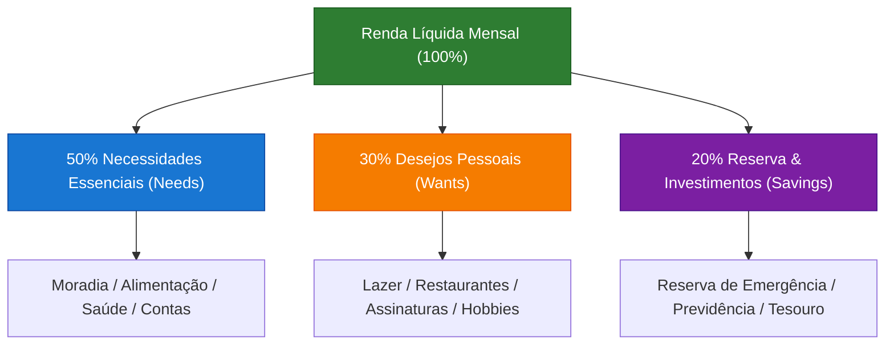
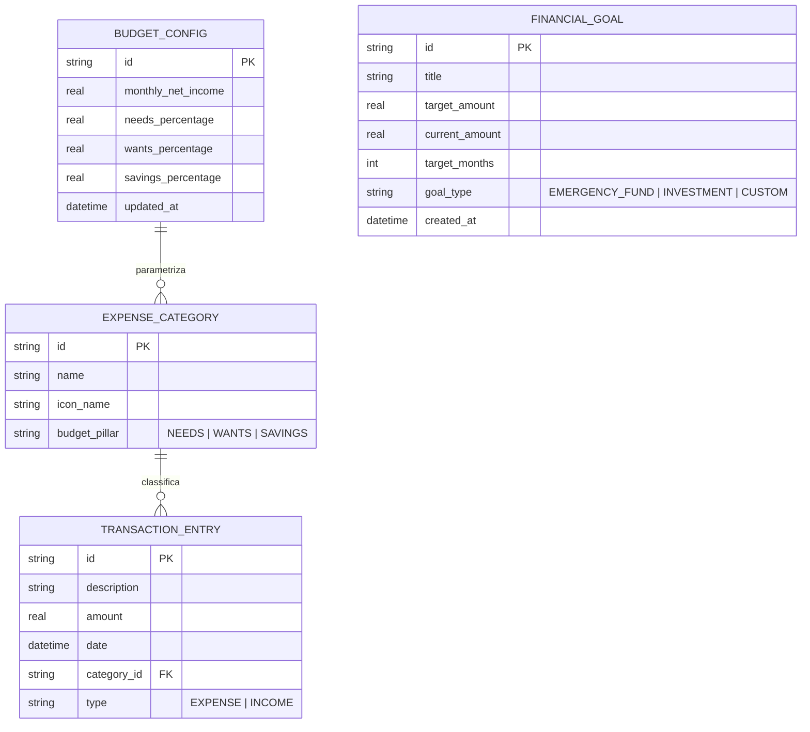

# FinFlow — Especificação Ágil da Sprint 2
## Módulo de Orçamento e Metas (Metodologia Regra 50/30/20)

---

### 1. Visão Geral e Contexto da Sprint

| Metadado | Detalhe |
| :--- | :--- |
| **Projeto** | FinFlow (Gestão Financeira Pessoal E2E Offline-First) |
| **Ciclo** | Sprint 2 (Duração: 2 semanas / 10 dias úteis) |
| **Papel Responsável** | Product Owner & Scrum Master (`scrum-po-lead`) |
| **Épico Relacionado** | `EP02 - Planejamento Orçamentário e Metas Patrimoniais` |
| **Stack Base** | Flutter 3.16+, BLoC, Drift (SQLite), fl_chart |
| **Status** | Aprovada para Execução (Ready for Dev) |

---

### 2. Objetivo da Sprint & Alinhamento de Valor de Negócio

#### 2.1. O Problema do Usuário (Cidadão e Servidor Público)
Servidores públicos e cidadãos assalariados possuem receitas recorrentes e previsíveis, porém frequentemente enfrentam:
1. **Sensação de descontrole orçamentário**: Falta de visibilidade de quanto da renda líquida já está comprometido com despesas fixas inegociáveis.
2. **Dificuldade de consolidação de reserva de emergência**: A ausência de metas estruturadas impede a alocação preventiva de capital antes do consumo discricionário.
3. **Erosão por gastos supérfluos invisíveis**: Pequenos gastos diários consomem a capacidade de investimento sem alertas proativos.

#### 2.2. Objetivo da Sprint (Sprint Goal)
> *"Entregar o módulo interativo de Orçamento 50/30/20 e Gestão de Metas Financeiras integrado ao extrato em tempo real, fornecendo ao servidor/cidadão feedback visual imediato de teto de gastos e progresso patrimonial com garantia de acessibilidade e segurança local."*

#### 2.3. Fundamentação da Regra 50/30/20
A metodologia orçamentária divide a renda mensal líquida em três baldes fundamentais:
- **50% Necessidades Essenciais (Needs):** Moradia, condomínio, alimentação básica, saúde, transporte essencial, contas de consumo (água, luz, gás).
- **30% Desejos e Estilo de Vida (Wants):** Assinaturas de streaming, lazer, restaurantes, viagens, compras pessoais, hobbies.
- **20% Metas e Futuro Financeiro (Savings/Debts):** Reserva de emergência (6 meses de despesas fixas), amortização de dívidas onerosas, previdência complementar (ex: Funpresp/RPPS/PGBL), Tesouro Direto.



---

### 3. Priorização e Trade-offs de Negócio

Para conciliar a restrição de prazo (Sprint de 2 semanas) com o máximo retorno de valor ao usuário, aplicamos os frameworks **MoSCoW** e **WSJF (Weighted Shortest Job First)**.

#### 3.1. Matriz MoSCoW
- **Must Have (Obrigatório na Sprint):**
  - Cálculo e dashboard da divisão 50/30/20 baseado nas despesas reais cadastradas.
  - Alertas visuais de limite (normal, atenção aos 80%, crítico aos 100%+).
  - Criação de metas com meta de valor, prazo e cálculo de aporte mensal sugerido.
  - Recálculo reativo via streams do Drift/BLoC quando despesas são criadas/atualizadas/excluídas.
- **Should Have (Desejável na Sprint):**
  - Gráfico em rosca animado com `fl_chart` e suporte a tooltips descritivas.
  - Simulação de meses restantes para atingimento da Reserva de Emergência conforme capacidade de aporte.
- **Could Have (Poderia ter se sobrar capacidade):**
  - Sugestão inteligente de reclassificação de categoria baseada no nome do estabelecimento.
- **Won't Have (Postergado para Sprints Futuras):**
  - Sincronização em nuvem / Open Finance automático (fora do escopo Offline-First da v1).
  - Compartilhamento familiar de orçamento.

#### 3.2. Análise WSJF (Weighted Shortest Job First)
Fórmula: $\text{WSJF} = \frac{\text{Custo do Atraso (CoD)}}{\text{Tamanho / Esforço (Job Duration)}}$ onde $\text{CoD} = \text{Valor de Negócio} + \text{Criticidade Temporal} + \text{Redução de Risco / Habilitação de Oportunidade}$.

| ID | Item de Backlog | Valor de Negócio (1-10) | Criticidade Temporal (1-10) | Redução Risco / Habilitação (1-10) | Custo do Atraso (CoD) | Esforço (Story Points) | Score WSJF | Prioridade |
| :--- | :--- | :---: | :---: | :---: | :---: | :---: | :---: | :---: |
| **US03** | Recálculo automático de categorias via Extrato | 9 | 9 | 10 | 28 | 5 | **5.60** | **#1** |
| **US01** | Visualização da Divisão 50/30/20 com Alertas de Teto | 10 | 8 | 8 | 26 | 5 | **5.20** | **#2** |
| **US02** | Metas de Reserva de Emergência e Investimentos | 8 | 7 | 8 | 23 | 5 | **4.60** | **#3** |

*Racional do Trade-off:* A **US03** (motor de recálculo reativo de categorias) obteve o maior WSJF porque serve de fundação arquitetural para a integridade dos dados consumidos pela visualização (US01) e pelas metas (US02).

---

### 4. Definição de Pronto (DoD) e Definição de Preparado (DoR)

#### 4.1. Definition of Ready (DoR) — Critérios de Entrada
Uma história só pode entrar na Sprint se cumprir:
1. [x] Descrição clara no formato Persona-Ação-Benefício.
2. [x] Critérios de Aceite expressos em sintaxe BDD/Gherkin cobrindo caminhos felizes, exceções e limites de borda.
3. [x] Wireframes / especificações visuais de UI definidos para os componentes de tela.
4. [x] Mapeamento de entidades de banco Drift e repositórios necessários.
5. [x] Estimativa consensual do time em Story Points (Planning Poker).

#### 4.2. Definition of Done (DoD) — Critérios de Conclusão e Entrega
Nenhum incremento é considerado pronto sem atender a todos os itens abaixo:
1. [x] **Arquitetura & Clean Code:** Código implementado segundo os padrões BLoC e Repository pattern, sem dependência de UI no domínio de negócio.
2. [x] **Acessibilidade Semantics (Obrigatório):**
   - Todos os elementos interativos possuem labels semânticos (`Semantics(label: ..., hint: ...)`).
   - O gráfico de rosca (`fl_chart`) fornece resumo descritivo alternativo em texto legível por leitores de tela (TalkBack / VoiceOver).
   - Relação de contraste de cores atendendo ao nível **WCAG 2.1 AA** (mínimo de 4.5:1 para texto e 3:1 para elementos de teto de gastos).
   - Suporte a escalas dinâmicas de texto sem overflow (`TextScaleFactor`).
3. [x] **Cobertura de Testes Automatizados:**
   - Testes unitários para regras de cálculo orçamentário (50/30/20, projeção de aportes) com cobertura $\ge 85\%$.
   - Testes de BLoC utilizando `bloc_test` cobrindo todos os estados e transições de erro/carregamento/sucesso.
   - Testes com `mocktail` para repositórios locais (Drift).
4. [x] **Segurança e Privacidade Offline-First:**
   - Nenhum dado financeiro trafegado em rede ou logado em plain-text no console de debug.
   - Cálculos e consolidações realizados 100% no cliente local.
5. [x] **Qualidade de Código:** Análise estática com `flutter analyze` sem erros ou warnings.

---

### 5. Histórias de Usuário & Critérios de Aceite (BDD / Gherkin)

---

#### História de Usuário 01 (US01)
**Título:** Visualização da Divisão Orçamentária 50/30/20 com Alertas Visuais de Teto de Gastos  
**Prioridade:** Must Have | **Estimativa:** 5 Story Points | **Épico:** EP02  

> **Como** servidor público ou cidadão consciente de suas finanças,  
> **Quero** visualizar graficamente a proporção dos meus gastos distribuídos nos pilares 50% (Necessidades), 30% (Desejos) e 20% (Metas/Poupança),  
> **Para que** eu identifique instantaneamente se estou extrapolando os limites seguros do meu orçamento mensal antes de fechar o mês no vermelho.

##### Critérios de Aceite (Gherkin):

```gherkin
Funcionalidade: Divisão Orçamentária 50/30/20 e Alertas de Teto

  Contexto:
    Dado que o usuário possui uma renda líquida mensal configurada de R$ 6.000,00
    E os tetos teóricos são:
      | Pilar                      | Percentual | Teto Máximo |
      | Necessidades Essenciais    | 50%        | R$ 3.000,00 |
      | Desejos e Estilo de Vida   | 30%        | R$ 1.800,00 |
      | Metas e Investimentos      | 20%        | R$ 1.200,00 |

  Cenário: Visualização de consumo dentro dos limites seguros (Zona Verde)
    Dado que as despesas acumuladas no mês corrente são:
      | Categoria   | Pilar          | Valor Consumido |
      | Moradia     | Necessidades   | R$ 2.000,00     |
      | Lazer       | Desejos        | R$ 800,00       |
      | Previdência | Metas          | R$ 1.200,00     |
    Quando o usuário acessa o dashboard de Orçamento
    Então o sistema deve exibir os pilares com os percentuais consumidos:
      | Pilar          | % da Renda Consumida | Status Visual |
      | Necessidades   | 33.3%                | Normal/Verde  |
      | Desejos        | 13.3%                | Normal/Verde  |
      | Metas          | 20.0%                | Meta Cumprida |
    E o leitor de tela deve anunciar: "Necessidades em 33.3 porcento do limite, dentro do planejado".

  Cenário: Alerta de atenção ao atingir 80% do teto estipulado (Zona Amarela)
    Dado que o usuário registrou despesas de "Desejos e Estilo de Vida" no valor acumulado de R$ 1.500,00 (83.3% do teto)
    Quando o usuário visualiza a barra de progresso de "Desejos"
    Então a barra deve apresentar a cor indicativa de Atenção (Amarelo Âmbar)
    E deve exibir o rótulo de alerta: "Atenção: 83% do teto de Desejos atingido. Restam R$ 300,00"
    E o elemento visual deve possuir rótulo de acessibilidade com indicação de aviso sonoro/tátil.

  Cenário: Alerta crítico ao ultrapassar 100% do teto da categoria (Zona Vermelha)
    Dado que o usuário registrou despesas de "Necessidades Essenciais" no valor de R$ 3.300,00
    Quando a tela de Orçamento for renderizada
    Então o pilar de Necessidades deve ser destacado em Vermelho de Perigo
    E deve exibir o aviso: "Teto excedido em R$ 300,00 (110% do limite)"
    E deve sugerir ação corretiva: "Rebalancear com o saldo de Desejos".

  Cenário: Renda líquida não informada
    Dado que o usuário ainda não cadastrou sua renda líquida mensal
    Quando ele acessa o Módulo de Orçamento
    Então o sistema deve exibir um card convidativo para informar o salário/renda líquida
    E não deve quebrar a renderização gráfica, apresentando estado vazio informativo.
```

---

#### História de Usuário 02 (US02)
**Título:** Criação e Acompanhamento de Metas de Reserva de Emergência e Investimentos  
**Prioridade:** Must Have | **Estimativa:** 5 Story Points | **Épico:** EP02  

> **Como** servidor público planejando minha estabilidade e aposentadoria,  
> **Quero** estipular metas financeiras parametrizadas (com valor alvo, categoria e prazo estimado),  
> **Para que** eu acompanhe o percentual acumulado, saiba o aporte mensal necessário e consolide minha reserva de emergência de 6 meses de despesas.

##### Critérios de Aceite (Gherkin):

```gherkin
Funcionalidade: Metas de Reserva de Emergência e Investimentos

  Contexto:
    Dado que o usuário está autenticado no aplicativo FinFlow

  Cenário: Sugestão automática de cálculo da Reserva de Emergência para Servidor
    Dado que a soma média de despesas essenciais mensais do usuário é de R$ 3.000,00
    Quando o usuário clica em "Criar Meta de Reserva de Emergência"
    Então o sistema deve sugerir automaticamente o valor alvo de R$ 18.000,00 (correspondente a 6 meses de despesas)
    E deve permitir que o usuário personalize o número de meses (ex: entre 3 e 12 meses).

  Cenário: Criação de meta com cálculo de aporte mensal sugerido
    Dado que o usuário define uma meta com:
      | Campo          | Valor                    |
      | Nome da Meta   | Reforma do Imóvel        |
      | Valor Alvo     | R$ 12.000,00             |
      | Saldo Inicial  | R$ 2.400,00              |
      | Prazo Desejado | 12 meses                 |
    Quando o usuário confirma a criação da meta
    Então o sistema deve calcular o saldo restante de R$ 9.600,00
    E deve exibir o aporte mensal sugerido de R$ 800,00/mês
    E deve vincular a meta ao pilar de 20% do Orçamento.

  Cenário: Registro de aporte e atualização imediata da barra de progresso
    Dado que a meta "Reserva de Emergência" tem R$ 5.000,00 de R$ 20.000,00 (25%)
    Quando o usuário realiza um aporte de R$ 1.500,00
    Então o saldo acumulado da meta deve ser atualizado para R$ 6.500,00
    E a porcentagem de conclusão deve avançar para 32.5%
    E o componente `Semantics` da barra de progresso deve atualizar seu valor lido para "32,5% concluído".

  Cenário: Validação de entradas inválidas na criação de metas
    Dado que o usuário tenta criar uma meta sem preencher o nome ou com valor alvo zerado/negativo
    Quando ele clica em "Salvar Meta"
    Então o sistema deve bloquear a submissão
    E destacar os campos com mensagens de validação acessíveis ("Informe um valor maior que zero").
```

---

#### História de Usuário 03 (US03)
**Título:** Recálculo Automático de Categorias a Partir das Despesas Cadastradas no Extrato  
**Prioridade:** Must Have | **Estimativa:** 5 Story Points | **Épico:** EP02  

> **Como** usuário que cadastra minhas transações no dia a dia,  
> **Quero** que as despesas inseridas, editadas ou excluídas no extrato reflitam automaticamente no cálculo dos pilares 50/30/20,  
> **Para que** meu orçamento esteja sempre atualizado em tempo real sem necessidade de consolidação manual ou recálculos lentos.

##### Critérios de Aceite (Gherkin):

```gherkin
Funcionalidade: Recálculo Reativo das Categorias Orçamentárias

  Contexto:
    Dado que o banco de dados Drift local está ativo com as categorias mapeadas:
      | Categoria          | Pilar 50/30/20          |
      | Aluguel            | Necessidades Essenciais |
      | Supermercado       | Necessidades Essenciais |
      | Restaurante        | Desejos Pessoais        |
      | Cinema             | Desejos Pessoais        |
      | Aporte Tesouro     | Metas e Investimentos   |

  Cenário: Inclusão de despesa recalcula o pilar correspondente via Stream
    Dado que o acumulado em "Necessidades Essenciais" é de R$ 1.200,00
    Quando o usuário cadastra uma nova transação:
      | Descrição    | Categoria     | Valor     | Data       |
      | Supermercado | Supermercado  | R$ 350,00 | 14/10/2026 |
    Então o valor acumulado de "Necessidades Essenciais" deve atualizar imediatamente para R$ 1.550,00
    E a tela de Orçamento deve refletir a nova proporção sem exigir recarga de tela.

  Cenário: Edição de transação reclassificando o pilar orçamentário
    Dado que uma transação de R$ 200,00 foi originalmente salva como "Restaurante" (Desejos)
    Quando o usuário edita a transação alterando a categoria para "Supermercado" (Necessidades)
    Então o saldo de "Desejos Pessoais" deve decrescer em R$ 200,00
    E o saldo de "Necessidades Essenciais" deve acrescer em R$ 200,00
    E ambos os gráficos e totalizadores devem ser sincronizados atomicamente.

  Cenário: Exclusão de transação do extrato
    Dado que uma transação de R$ 500,00 no pilar "Metas e Investimentos" existe no extrato
    Quando o usuário remove essa transação confirmando a caixa de diálogo
    Então a transação é removida do banco SQLite local
    E o saldo do pilar "Metas e Investimentos" deve abater instantaneamente R$ 500,00.

  Cenário: Tolerância a transações sem categoria atribuída
    Dado que uma despesa foi importada ou criada sem categoria definida
    Quando o motor de recálculo processa os dados do mês
    Então a despesa deve ser agrupada provisoriamente sob a seção "Não Categorizados"
    E o sistema deve exibir um badge de alerta sugerindo a classificação para correta apuração do 50/30/20.
```

---

### 6. Arquitetura de Dados & Modelo Funcional (Drift / BLoC)

#### 6.1. Diagrama de Entidades do Módulo Orçamentário


#### 6.2. Fluxo Reativo (Offline-First via BLoC e Drift Streams)
1. **Drift DAO (`BudgetDao`):** Emite `Stream<BudgetConsolidation>` agregando `transactions` agrupadas por `budget_pillar` no mês de referência.
2. **`BudgetBloc`:** Escuta o stream do DAO, aplica as regras de negócio de teto (80% atenção, 100% estouro), e emite `BudgetLoadedState(summary, alerts)`.
3. **Flutter UI (`BudgetScreen`):** Renderiza o gráfico de rosca (`fl_chart`), barras de progresso com contraste WCAG e nós `Semantics` para leitores de tela.

---

### 7. Plano de Testes & Critérios de Verificação Técnica

| Nível de Teste | Alvo do Teste | Ferramentas | Cobertura Mínima |
| :--- | :--- | :--- | :--- |
| **Unitário (Domain)** | Cálculos matemáticos da regra 50/30/20, limites e metas | `flutter_test` | 90% |
| **Unitário (BLoC)** | Transições de estado do `BudgetBloc` e `GoalsBloc` | `bloc_test`, `mocktail` | 85% |
| **Integração (DAO)** | Queries reativas do Drift e filtros por mês/ano | `drift/native`, `test` | 80% |
| **Acessibilidade** | Labels semânticos, contraste de cores e navegação por foco | `SemanticsTester`, Flutter Inspector | 100% de conformidade WCAG AA |

---

### 8. Gestão de Riscos da Sprint

| Risco Identificado | Severidade | Probabilidade | Estratégia de Mitigação |
| :--- | :---: | :---: | :--- |
| **Performance em recálculos frequentes** com muitas transações | Média | Média | Utilizar queries agregadas SQL (SUM/GROUP BY) diretamente no Drift SQLite ao invés de cálculos em memória no Dart. |
| **Dificuldade de interpretação do gráfico** por usuários daltônicos | Alta | Baixa | Adotar ícones e rótulos textuais explícitos além da diferenciação por cor (padrão WCAG). |
| **Mudança na renda líquida no meio do mês** | Baixa | Média | Permitir versionamento de renda por competência (Mês/Ano). |

---

### 9. Próximos Passos e Cerimônias da Sprint

1. **Sprint Planning:** Alinhamento técnico de dependências de DAOs e Widgets modulares.
2. **Daily Standups:** Acompanhamento da queima de pontos focando primeiramente na US03 (motor reativo) para desbloquear a US01 e US02.
3. **Sprint Review:** Demonstração prática do fluxo de inserção de despesa gerando alertas de teto no dashboard e teste de acessibilidade com leitor de tela ativo.
4. **Sprint Retrospective:** Avaliação da fidelidade às metas de DoD e cobertura de testes.
